 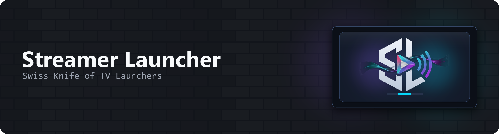
 
 # Streamer Launcher

<p align="center">
  <strong>An ultra-fast, minimal, and elegant home screen engineered specifically for Android TV and Google TV.</strong>
</p>

<p align="center">
  <a href="https://github.com/raviprakashji/Streamer-launcher-release/releases/latest"></a>
  
  
  
   
  <a href="LICENSE"></a>
</p>


---

## Product Showcase

> **Screenshot placeholders:** The image paths below are reserved for your updated screenshots. Upload the corresponding images to `docs/screenshots/` when ready. Each feature can have multiple screenshots; add or remove gallery cells as needed.

### 🏠 Home Screen & Launcher

| Main Home Screen | Clutter-Free Home Screen | Continue watching & Catalogs |
| :---: | :---: | :---: |
|  |  | 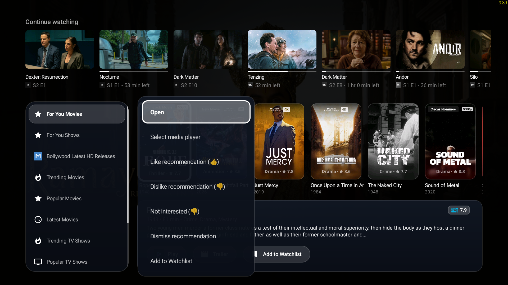 |

### 🎬 Movie & TV Discovery

| Trending & Popular Catalogs | For You — Movies | Trailer Playback up to 4K|
| :---: | :---: | :---: |
|  |  |  |

### ▶️ Playback Integrations

| Preferred Player Selection | Gemini Search Playback | Catalog Direct Playback |
| :---: | :---: | :---: |
|  |   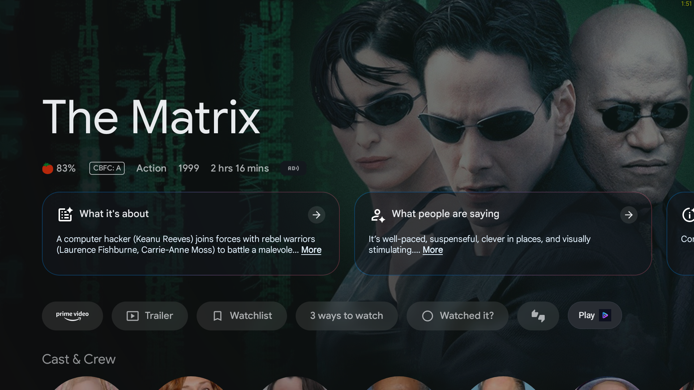 |  |

### 📅 TV Show Calendar

| Your Shows | All Premieres |
| :---: | :---: |
|  | 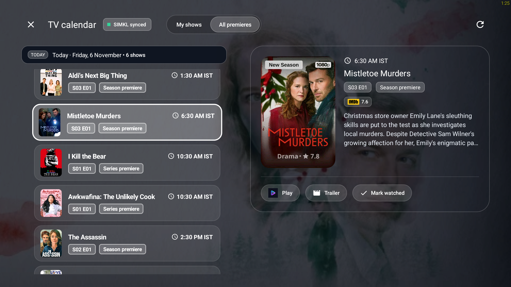 |

### 🎵 In-built Music Player

| Music Home & Quick Mixes | Synchronized Lyrics |
| :---: | :---: |
|  | 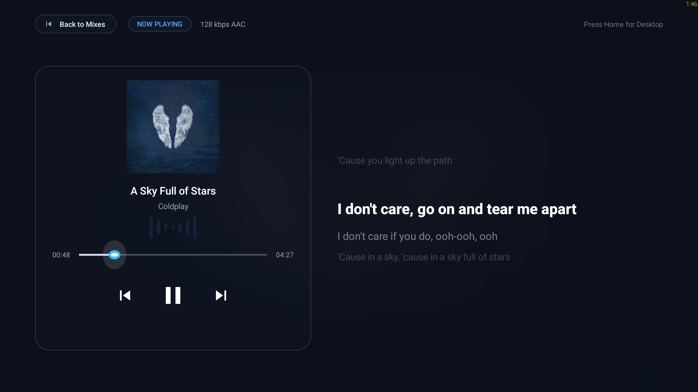 |

### 🏏 Live Cricket

Home Screen Live Scores & Match Schedule |
| :---: |
|  |

### 🖼️ Wallpapers

| Full Cinema | Minimal Logo | Clean Posters |
| :---: | :---: | :---: |
|  | 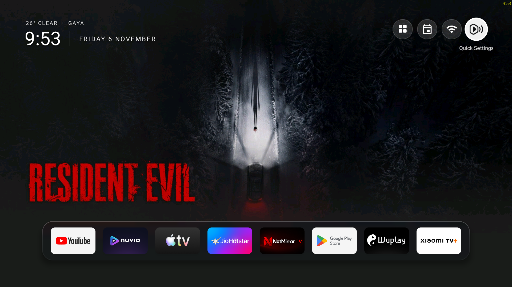 |  |

### 📁 File Manager & LocalSend

| Built-in File Manager | LocalSend File Transfer | File Selection |
| :---: | :---: | :---: |
| 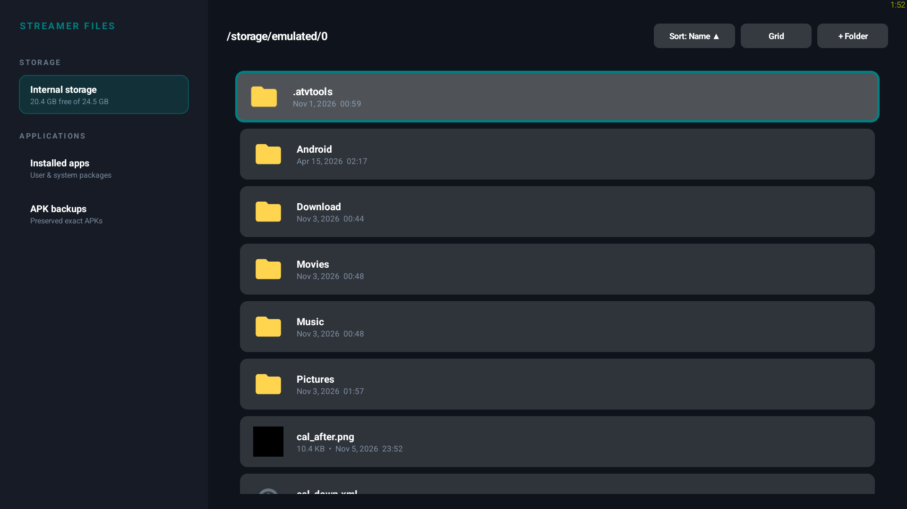 |  | 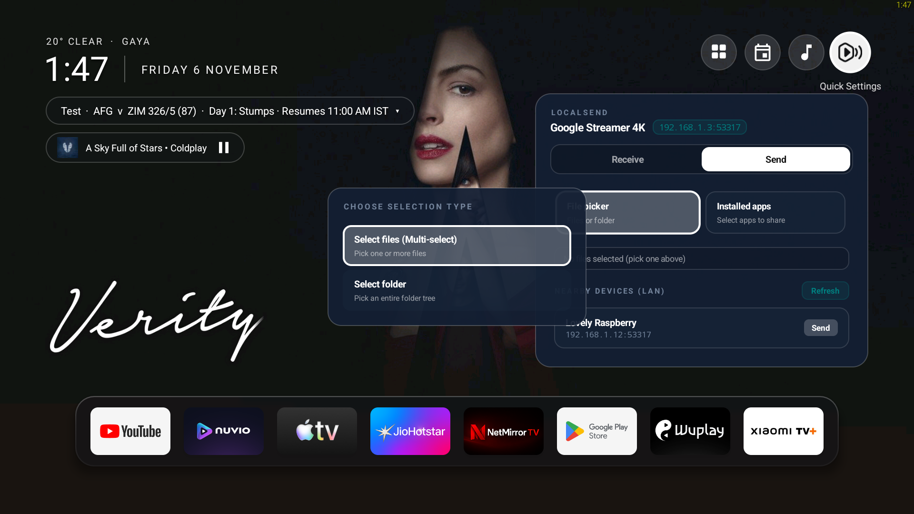 |
| Multiple App Transfer | LocalSend Transfer in Progress | Transfer Completed |
|  | 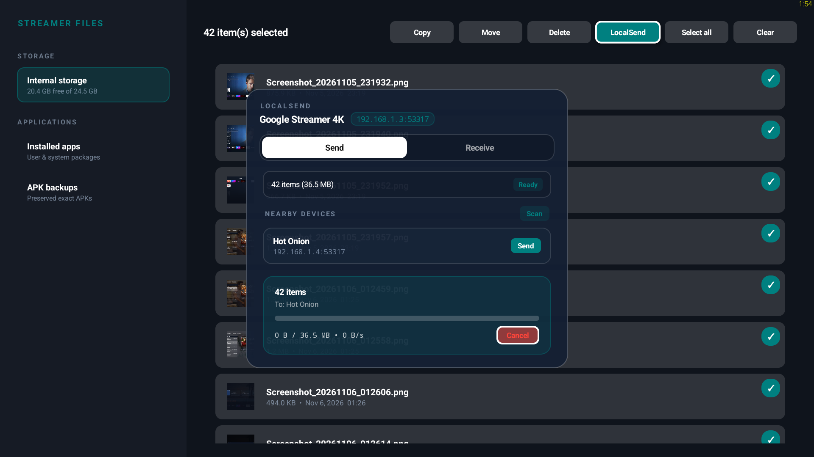 | 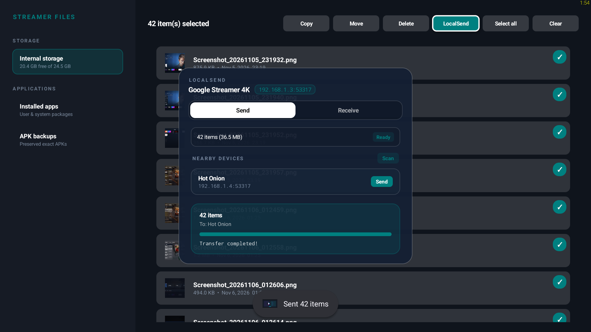 |

### 🎛️ Remote & Device Controls

| Button Remapper | Button Alias & Press Actions | HDMI Input Selection |
| :---: | :---: | :---: |
|  |  | 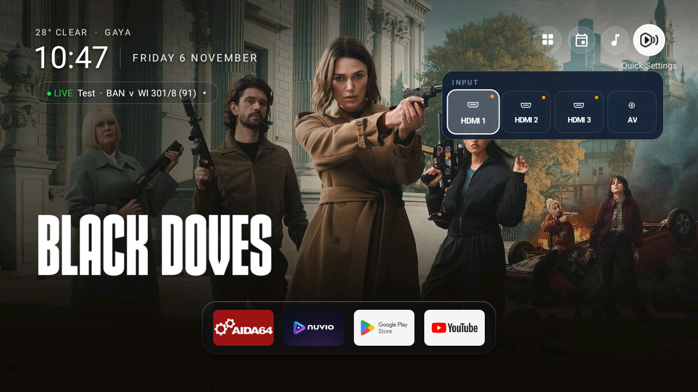 |

### ⚙️ Settings, Backup & Updates

| Main Settings | MDBList API Configuration | Backup & Restore |
| :---: | :---: | :---: |
|  |  |  |

---

## Key Features

- **Ultra-Light Android TV Launcher**:
  - Integrated date, weather, and clock with fast pre-cached cold-boot wallpaper and dock startup.
  - Liquid-glass app dock (`DockPillView`) with adaptive contrast over dark and light wallpapers, supporting up to **8 apps**, custom icon sizing, app icon tinting, and focus ring accent colors.
  - Compatible with **Projectivy, ADW, Nova, and Lawnchair icon packs** (`Apply icon pack` & long-press `Choose from icon pack`), custom icon uploads, and one-click Projectivy Icon Pack APK installation.
  - Rearrange or remove apps from the dock.
  - Clutter-free home screen option, including controls to hide the cricket score pill.
  - Configurable home screen dimming during a selected time interval.
- **Built-in File Manager & LocalSend v2**:
  - TV-friendly file manager designed for remote D-pad navigation with pure-Kotlin **exFAT / FAT32** USB Mass Storage OTG support and in-app image previews.
  - LocalSend v2 built in for local wireless file transfers.
  - Open LocalSend directly from the File Manager to send and receive files between devices.
- **Unified Media Discovery & Search Explorer (Page 2)**:
  - Full-screen Media Discovery Explorer and Search Engine (`isSearchPage2Enabled`) with smooth vertical scroll navigation between Page 1 and Page 2.
  - Interactive header bar combining:
    - **Voice & D-Pad Search**: High-speed search with built-in Voice Search (`android.speech.RecognizerIntent`) and on-screen keyboard filtering.
    - **TV Show Calendar**: Integrated directly into the Page 2 header bar (between Search and Watched toggle) for immediate schedule access; Back and D-pad Home cleanly return to Page 2.
    - **Watched Toggle**: Quick visibility filter pill (`Watched: Shown` / `Watched: Hidden`) for immediate catalog filtering.
    - **Category Filters**: Filter chips for **All**, **Movies**, and **Shows** with smart media format routing.
    - **Catalog Taxonomy & Live Counter**: Inline genre indicator and dynamic title count badge.
    - **Player Selection Pill**: Direct preferred player switcher (Nuvio variants, Stremio, CloudStream, or None with graceful handling).
  - Three-tier sliding taxonomy explorer: Browse genres (Action, Adventure, Comedy, Crime, Sci-Fi, etc.), subgenres / decades, and rich 5-column poster grids with 0% overlap.
  - Live synopsis box and backdrop previews updating dynamically as posters gain focus.
  - 24-hour disk cache and 800ms query LRU cache, completely eliminating cold-start blank screens and navigation lag.
  - Master feature switch under `Streamer settings → Turn features on/off → Discover catalogs Page 2`.
- **Preferred Media Player & Direct Playback**:
  - Choose **Nuvio** (including `com.nuvio.tv`, `com.nuvio.app`, `com.nuvio.tv.lite`, and other installed variants), **Stremio**, or **CloudStream** as the preferred external media player.
  - Launch supported titles directly from Google Gemini search results (requires Gemini to be available on the TV).
  - Launch titles directly from built-in catalogs and Continue Watching.
- **Custom App Icons & Live Video/GIF Wallpapers**:
  - **Custom App Icon Upload**: Upload custom images for any app on the dock or All Apps drawer with support for PNG, JPG, WEBP, and GIF formats (max file size: **6 MB**), or choose directly from installed icon packs.
  - **Video Wallpapers**: Background video loop playback (MP4, MKV, WebM) with hardware-safe RAM thresholds:
    - Devices with **≤ 1.6 GB RAM**: Max video size **35 MB** (1080p max resolution).
    - Devices with **≤ 2.5 GB RAM**: Max video size **55 MB** (1080p max resolution).
    - Devices with **≤ 3.5 GB RAM**: Max video size **75 MB** (up to 4K).
    - Devices with **> 3.5 GB RAM**: Max video size **100 MB** (up to 4K).
  - **Animated GIF Wallpapers**: Native infinite-loop playback for GIF and animated WEBP wallpapers using Android `AnimatedImageDrawable`.
  - Custom photos, folders, and Bing Daily wallpapers render cleanly without any top shadow or haze by default (`Appearance → Photo fade` defaults to **Off**), with raw-image luminance detection adapting clock and top-bar icons automatically.
- **Centralized Feature Controls & Quick Navigation**:
  - Dedicated **Turn features on/off** menu in Main Settings with master switches to toggle **Music**, **Continue watching**, and **Discover catalogs Page 2**.
  - Long-press **Quick Settings** to open Android System Settings directly; top-bar **Wi-Fi** shortcut (when Music is off) opens Android Wi-Fi Settings directly with D-pad focus preserved on return.
- **Hardware HDMI & AV Input Switcher**:
  - Select supported HDMI and AV inputs directly from the launcher.
- **Hardware Remote Button Remapper & Universal Floating Overlays**:
  - Remap supported TV remote buttons with zero-latency, sub-microsecond $O(1)$ key lookup and dynamic accessibility filtering bypass.
  - Add custom aliases to make buttons easier to identify.
  - Configure independent single-press, double-press, and long-press actions.
  - **Works Anywhere Floating Overlays**: Launch Quick Settings, Live Cricket Scores, full LocalSend file transfer, Music HUD, Streamer Settings, or App Dock directly over any running app or video player (YouTube, Netflix, etc.) without leaving your content or interrupting playback.
  - **Categorized Actions**: Streamer features cleanly organized into **Works anywhere** and **Works from homescreen** sections.
- **MDBList Account Integration**:
  - Connect using your personal MDBList API key.
  - Add personal MDBList catalogs, including dynamic and static lists.
- **Backup & Restore**:
  - Export and restore launcher settings and configured API keys.
- **Over-the-Air Updates**:
  - Check for and install launcher updates without manually downloading each release.
- **Low-Memory Engineering**:
  - Lightweight interface and asynchronous data handling designed for entry-level Android TV hardware.

---

## ⚡ Resource & Performance Profile (RAM & CPU)

Streamer Launcher is strictly engineered for low-memory, entry-level Android TV and Google TV hardware (benchmarked on a physical **MediaTek MT5867 Quad-Core with only ~929 MB Total RAM on Android 11**):

### Before vs After v4.2.1 Deep Optimizations

| Operating State | Baseline (v4.2) Total RAM | Optimized (v4.2.1) Total RAM | Java Heap (v4.2.1) | Graphics & Native (v4.2.1) | CPU Usage | Real-World Scenario |
| :--- | :---: | :---: | :---: | :---: | :---: | :--- |
| **Idle / Cold Start** | ~48 MB | **~40 MB** *(16.7% ↓)* | ~4.8 MB | ~12.6 MB | **0.0% – 0.5%** | Fresh launch, sitting idle on the Home dock, background threads completely asleep. |
| **Normal Active Navigation** | ~65 MB | **~73 MB** | ~6.7 MB | ~37.0 MB | **0% – 8%** | Browsing home apps, Page 2 catalogs, opening item context menus, and scrolling recommendations. |
| **Peak / Max Workload** | ~108 MB | **~83 MB** *(23.1% ↓)* | ~9.3 MB | ~44.5 MB | **15% – 25%** | All 8 catalog rows loaded, live cricket score ticker scrolling, YouTube Music streaming in the background, TV Calendar with airing posters open, and 1080p wallpaper rotation. |

### Architectural Highlights
- **Zero Idle Drain (Reactive, Not Polling)**: Completely event-driven architecture with zero background timer loops or busy-wait polling. When inactive, CPU drops to **0%**.
- **Streaming JSON & Request Deduplication**: Multi-megabyte SIMKL TV calendar and watchlist feeds use a streaming parser (`StreamingJsonReader`) with single-flight request coalescing (`fetchWatchlistCoalesced`), eliminating redundant JSON memory allocations and duplicate network bursts.
- **Main-Thread Decoupling**: Item context menus and watched caches are warmed asynchronously in the background. Opening menus takes **<1 ms** with **0 ms** synchronous disk I/O on the Android main thread.
- **Safe for Sub-1GB RAM Devices**: Stays well below the Android TV 192 MB low-memory threshold even under maximum concurrent load, guaranteeing zero system lag or background app evictions.

---

## Technical Architecture

```
+-------------------------------------------------------------------------------+
|                               Streamer Launcher                               |
+---------------------------------------+---------------------------------------+
|              Data Layer               |               UI Layer                |
|  - TMDB API & Multi-Rating Engine     |  - Lightweight Android View Hierarchy |
|  - MDBList & SIMKL Watchlists Engine  |  - SnapScrollView (60fps D-pad Paging)|
|  - SIMKL Taste Profile AI Engine      |  - Floating Quick Settings Glass Panel|
|  - Streaming TV Calendar (16-day Win) |  - Streamer Music Player & Visualizer |
|  - YouTube Music & Audio Extractor    |  - Status Bar Now Playing Pill Widget |
|  - Single-Flight Request Coalescing   |  - DockPillView (Frosted Blur Glass)  |
|  - LocalSend LAN Engine (v2 Protocol) |  - Ambient Dimmer Alpha Controller    |
|  - Streamer Files Manager & Installer |  - Dynamic Backdrop & Wallpaper Sync  |
|  - Backup & Restore JSON Engine       |  - Live Cricket Ticker Pill & Overlay |
|  - Android WatchNext Provider         |  - Media Player Relay Accessibility   |
|  - CricketData Live Score Engine      |  - TV Calendar Modal & Timeline View  |
|  - Button Mapper Input Handler        |  - LocalSend Modal & File Transfer UI |
|  - SurfaceFlinger Hardware Screenshot |  - Hardware HDMI / AV Input Switcher  |
+---------------------------------------+---------------------------------------+
|                          Hardware & Media Pipeline                            |
|  - Media3 ExoPlayer 1.5.1 (1440p/1080p Video + YouTube Audio Stream Mux)      |
|  - Android Jetpack ProfileInstaller (Zero-Permission AOT Machine Compilation) |
|  - RGB_565 Decoded Bitmaps & Texture Recycling (Zero GC Stalls, Low Heap)     |
|  - Asynchronous Background Watched Cache Warmup (0 ms Main-Thread Disk I/O)   |
|  - SurfaceFlinger HardwareBuffer Direct Capture (Android 14 API 30+ Compliant)|
|  - R8 Full-Mode Minification & Multi-Pass Resource Shrinking (3.8 MB APK)     |
+-------------------------------------------------------------------------------+
```

---

## TV Remote Navigation Guide

| Action | Remote Key / Gesture |
| :--- | :--- |
| **Move Focus** | <kbd>Up</kbd> <kbd>Down</kbd> <kbd>Left</kbd> <kbd>Right</kbd> Directional Pad (D-pad) |
| **Launch App / Media** | <kbd>OK</kbd> / <kbd>Enter</kbd> (Center Button) |
| **Switch Pages** | <kbd>Down</kbd> from dock transitions smoothly to Page 2 (Discover Catalogs) |
| **All Apps Shortcut** | Press <kbd>Up</kbd> from anywhere in the app dock to focus the All Apps icon |
| **Open Quick Settings** | Select the Quick Settings icon from the top bar (cyclic D-Pad tile navigation) |
| **Now Playing Shortcut** | Select the Now Playing pill in the status bar to jump directly into the music player |
| **Music Player Controls** | <kbd>OK</kbd> to Play/Pause, <kbd>Left</kbd> / <kbd>Right</kbd> on seekbar to scrub by 5s, shuffle toggle, track queue |
| **Open TV Calendar** | Select the Calendar icon from the top bar |
| **LocalSend Transfer** | Select the LocalSend icon from the top bar to send/receive files |
| **Streamer Files** | Select the File Manager icon from the dock or top bar to browse files/APKs |
| **HDMI / AV Input** | Select an HDMI or AV input icon to switch TV hardware source |
| **Item Context Menu** | Long-press <kbd>OK</kbd> on any catalog poster for instant (<1 ms) details and SIMKL status |
| **Quick Play / Trailer** | Highlight movie poster -> Press <kbd>Up</kbd> to access Play and Trailer buttons |
| **App Management** | Long-press <kbd>OK</kbd> on any dock app to rearrange or hide |
| **Back / Exit Modal** | <kbd>Back</kbd> key closes music player, trailers, search dialogs, calendar, and settings |

---

## Installation

### Option 1: Direct APK Download
Download the latest pre-compiled release from the [Releases Page](https://github.com/raviprakashji/Streamer-launcher-release/releases/latest):
- **Streamer.launcher_v4.2.2.apk** (4.5 MB)

### Option 2: Install via ADB
```bash
# 1. Connect to your TV over Wi-Fi
adb connect <your-tv-ip>:5555

# 2. Install the APK
adb install -r "Streamer.launcher_v4.2.2.apk"
```

### Grant Secure Settings Permission (Required for Certain System-Level Features)

Streamer Launcher uses Android's `WRITE_SECURE_SETTINGS` permission for certain system-level features. Android does not allow an ordinary app to grant this permission to itself, so grant it once from a computer connected to your TV through ADB:

```bash
adb shell pm grant com.streamer.launcher android.permission.WRITE_SECURE_SETTINGS
adb shell cmd package set-home-activity com.streamer.launcher/.MainActivity
```

**Steps:**
1. Enable **Developer options** and **USB debugging** or **Wireless debugging** on your Android TV.
2. Connect to the TV from your computer using ADB.
3. Run the command above.
4. Restart Streamer Launcher if the affected feature does not immediately detect the permission.

**Note:** This permission can be granted through ADB without root access. It is a privileged Android permission, not an Accessibility Service enablement step; granting it does not turn on an Accessibility Service.

---

## Building from Source

### Prerequisites
- **JDK 17** (Temurin or OpenJDK recommended)
- **Android SDK** (API Level 36, Build Tools 34.0.0)

### Build Commands
```bash
# Clone the repository
git clone https://github.com/raviprakashji/Streamer-launcher.git
cd Streamer-launcher

# Run unit tests
./gradlew test

# Compile release APK
./gradlew assembleRelease
```
The compiled APK will be located at:
`app/build/outputs/apk/release/Streamer.launcher_v4.2.2.apk`

---

## Changelog

### v4.2.3
- **Quick Settings Zen Mode Tile**:
  - **Clutter-Free Homescreen**: Added a dedicated "Zen mode" tile on Row 6 (left of Ambient Screensaver) to instantly strip homescreen distractions down to a pure, minimal wallpaper and dock view.
  - **One-Click Multi-Component Toggle**: Clicking Zen mode disables Continue Watching, the entire Page 2 catalogs, Streamer Music, and Shortcuts & Activities in a single action while cleanly saving prior user preferences.
  - **Automatic State Restoration**: Clicking again instantly restores all 4 components back to their exact previous on/off settings.
  - **Active Accent & Labeling**: Highlights in `#C084FC` violet/purple border and glow with dynamic `"Active"` / `"Off"` subtitle labels and custom meditating Zen iconography (`ic_zen.xml`).
  - **Bi-directional Settings Sync**: Manually re-enabling any of the 4 features via *Streamer settings -> Turn features on/off* automatically synchronizes Zen mode back to `Off`.
- **Streamer Settings Overlay Dismiss & Focus Trapping**:
  - **Clean Home Dismissal**: Pressing the remote Home button while Streamer settings is open now cleanly dismisses the settings overlay and returns focus directly to the homescreen dock, fixing an issue where settings stayed open while focus slipped underneath.
  - **Unconditional Scrim Teardown**: Hardened `closeLauncherSettings()` to dismiss overlays and tear down `settingsScrim` unconditionally, preventing stale overlay states across activity transitions and paused intent dispatches.
  - **DPAD Vertical Focus Trapping**: DPAD DOWN and UP navigation strictly confines focus within the Streamer Settings card, preventing focus traversal from accidentally jumping out to the app dock.
- **Continue Watching 5th Card Blink Elimination**:
  - Resolved the spatial focus jump glitch where the partially visible 5th Continue Watching card briefly blinked or highlighted when dismissing Quick Settings on the homescreen via DPAD Home.
  - Suppresses Continue Watching descendant focusability during Quick Settings dismissal until focus has safely settled on the active dock app.
- **Appearance & Wallpaper Enhancements**:
  - **Dim Homescreen Components Default**: When *Appearance -> Dim homescreen components* is ON, Continue Watching cards (both classic and minimalist layouts) are now hidden by default for maximum wallpaper visibility.
  - **Persistent Clock Page 1 Suppression**: Added a dedicated sub-toggle for *"Hide on homescreen page 1"* under *Appearance -> Persistent clock* (visible only when Persistent Clock is ON), allowing the persistent clock to stay hidden on page 1 while showing on subsequent pages and scrolling.
  - **Recursive Wallpaper Folder Scanning**: The wallpaper directory picker now scans subfolders recursively (e.g. categorized directories like Abstract, Animals, Anime, Cars), automatically cycling through all nested wallpapers without requiring manual flattening into a single root folder.
  - **Button Mapper "Change Wallpaper" Action**: Added *"Change wallpaper"* under *Button mapper -> Streamer features -> Works anywhere* (sorted alphabetically), enabling one-click manual wallpaper cycling for both local custom folders and TMDB backdrops from anywhere.

### v4.2.2
- **Universal Floating Overlays Over Running Apps**:
  - **Overlay Architecture**: Remapped remote buttons now launch floating overlays directly over any foreground application or active video playback (e.g., YouTube, Netflix, Prime Video) without switching tasks or displaying the home screen.
  - **Quick Settings Overlay**: Slide-in floating panel for Wi-Fi management, audio output switching, ambient settings, sleep timers, and media controls over any active app.
  - **Bluetooth Accessories Overlay**: Remote Button Mapper action and Quick Settings tile now launch `BluetoothOverlay` directly over running apps without opening launcher, preserving exact homescreen modal placement. Includes smooth transition into "Pair new device" scanning view and clean dismissal when opening Bluetooth system settings.
  - **HDMI Inputs Overlay**: Remote Button Mapper action and Quick Settings tile launch `HdmiInputsOverlay` directly over running apps at the exact same position as homescreen without disturbing background playback.
  - **Cricket Scores Overlay**: Floating top-right live match score card with marquee scrolling, full over/wicket details, and auto-dismissal.
  - **LocalSend Overlay**: Complete dual-tab LocalSend transfer interface floating over apps with full file-picker and app-sharing support. Fixed an issue where picking files or pressing Back in file manager closed background apps by isolating task affinities.
  - **Music HUD Overlay**: Floating bottom playback bar with synchronized lyrics and media transport controls.
  - **Streamer Settings Overlay**: Side panel launcher settings overlay floating directly over foreground apps with dark scrim, smooth back navigation, and **continuous infinite DPAD hold scrolling** (300ms initial threshold, 75ms repeat cadence, seamless wrapping between top and bottom).
  - **App Dock Overlay**: Floating quick dock with smooth exit animations and clean D-pad traversal.
  - **Background Catalog & Score Refresh**: Asynchronous catalog and live score refresh triggered via remote buttons with toast feedback, without leaving the active app.
- **Button Mapper Feature Organization & Outside Homescreen Actions**:
  - Streamer features in Button Mapper are organized into two distinct, intuitive sections in alphabetical order:
    - **Works anywhere**: *App dock, Bluetooth accessories, Cricket scores, LocalSend, Quick settings, Refresh catalogs, Streamer Files, Streamer settings, Switch HDMI input*
    - **Works from homescreen**: *Calendar, Streamer Music, Streamer search*
  - **Streamer Files**: Moved to *Works anywhere* in alphabetical order; remapped buttons launch `FileManagerActivity` directly with `FLAG_ACTIVITY_NEW_TASK` from any app outside homescreen.
- **Button Mapper Performance & Architectural Optimizations**:
  - **$O(1)$ Primitive Key Lookup**: Replaced linear key scans with primitive-indexed `SparseArray` lookups (`keyCodeMap` and `scanCodeMap`), achieving zero-allocation, sub-microsecond key dispatch on TV remotes.
  - **Dynamic Accessibility Key Filtering Bypass**: Strips `FLAG_REQUEST_FILTER_KEY_EVENTS` when idle (no buttons mapped, no overlays visible), eliminating accessibility IPC input latency across the entire Android TV OS.
  - **Asynchronous Disk & Graphic Execution**: Moved hardware buffer bitmap wrapping and screenshot disk writing off the main UI thread into dedicated `AppExecutors.diskIo` thread pools.
  - **Blink-Free Compositor Transitions**: Fixed hardware layer flickering over playing video by animating inner card containers directly and consuming `ACTION_DOWN` of Back/Escape while strictly dismissing on `ACTION_UP`.

### v4.2.1
- **Shortcuts & Activities & Activity Explorer Polish**:
  - **Quick Presets Focus Retention**: Fixed DPAD UP navigation from preset cards in "System & Dev" and "Files & Hardware" categories resetting to "All Presets". Focus now accurately returns to the active category filter pill.
  - **Zero-Flicker Tab Navigation**: Removed 150ms artificial delay and implemented view retention across Activity Manager tabs, eliminating jitter, re-inflation lag, and focus-stomping.
  - **Quick Presets IPC Caching**: Caches resolved system settings intents to eliminate 12 synchronous `PackageManager` IPC calls on every render and category switch.
  - **Declared Activities LRU Cache**: Implemented a 32-entry LRU cache for package activities in Activity Explorer, making app-switching instantaneous with zero Binder overhead.
  - **Activity Launcher Drawer Tile Decode Caching**: Tile bitmap decode is now cached in `iconCache`, eliminating repeated flash storage reads on All-Apps drawer redraws.
  - **Activity Explorer DPAD Traversal Optimization**: Removed redundant recursive `findViewById` loop that ran across all activity cards on every single package DPAD step.
  - **Thread-Safe Dexopt Compilation**: Migrated compiler cache to `ConcurrentHashMap<String, String>` and eliminated intermediate collection allocations during installed apps resolution.
- **System-Wide Memory & Performance Engineering**:
  - **Installed Apps $O(1)$ Leanback Resolution**: Replaced linear list scanning (`leanbackActivities.any { ... }`) with $O(1)$ set lookup (`a.packageName in leanbackPkgSet`), speeding up app discovery on boot and resume.
  - **App Folder Caching & Collage Icon LRU**: Added in-memory folder state caching (`cachedFolders`) and 32-entry LRU cache for 2x2 folder collage drawables (`collageCache`), eliminating continuous JSON parsing and bitmap/canvas allocations during home dock navigation.
  - **Recommendation Scoring Regex & Genre Parsing Optimization**: Promoted IMDb ID pattern matching to static compiled regex (`IMDB_ID_REGEX`), extracted static unscripted genre keys, and eliminated duplicate string splitting across candidate scoring passes.
  - **Zero-Allocation Clock Overlay Formatting**: Replaced per-minute `SimpleDateFormat` allocations with thread-safe reusable date formatters.
  - **Buffered Backup & Restore Extraction**: Accelerated wallpaper and custom icon archive restoration by wrapping output streams with `BufferedOutputStream`.
  - **Local ADB RSA Keypair Caching**: In-memory caching for ADB keypairs eliminates redundant disk reads and cryptographic key rebuilding across shell operations.
- **Atomic File Persistence Durability & Recovery Hardening (`SafeFilePersistence`)**:
  - **Strict File-Sync Failure Handling**: Enforced strict `fos.fd.sync()` checks during persistence operations; aborts replacement, safely cleans up incomplete temporary files, and leaves original valid targets completely intact if sync fails.
  - **Deterministic Backup & Recovery Paths**: Added comprehensive testing and validation covering replacement failures after backup creation, crash recovery during interruptions, and stale backup protection.
- **Resource Footprint Reductions**:
  - **Idle / Cold Start Total PSS**: Reduced from ~48 MB to **~40 MB** (16.7% reduction).
  - **Peak Workload Total PSS**: Reduced from ~108 MB to **~83 MB** (23.1% reduction).

### v4.2
- **Page 2 Snake Navigation**:
  - **Seamless Continuous Grid Navigation**: Pressing `DPAD RIGHT` from the final poster of any catalog row now wraps seamlessly to the first poster of the next row below, enabling natural continuous browsing without backtracking.
  - **Fluid Sidebar Escape**: Pressing `DPAD LEFT` from the first poster of any row returns focus directly to the genre sidebar navigation rail without trap or jarring focus skips.
- **Invisible Dock Theme & Custom Tile Borders**:
  - **Invisible Dock Preset**: Added `Invisible` preset to Dock & Icon Theme settings, completely hiding the dock pill background while maintaining app icon alignment and crisp visibility over wallpapers.
  - **Configurable Tile Borders**: Introduced dedicated border styling (App colour, Glass outline, Off) and custom border opacity sliders specifically tuned for the Invisible dock.
  - **Context-Aware Settings Safeguards**: Focus Effect menu is intelligently disabled and dimmed when the Invisible preset is active to avoid visual conflicts with borderless icons.
- **Aurora Flow Live Wallpaper & Ambient Screensaver**:
  - **Native OpenGL ES Shader Engine**: Integrated `AuroraLiveView` utilizing an optimized GLSL fragment shader simulating natural multi-layered aurora borealis wave physics and color shifting.
  - **Wallpaper & Screensaver Dual Mode**: Selectable directly as a live home screen wallpaper or as an ambient screensaver with zero stutter and low thermal overhead.
- **Animated Icon Idle Optimization**:
  - **Low-Power Idle Freeze**: Animated dock icons now cleanly render their static baseline frame (`Frame 0`) when idle and only engage dynamic frame-by-frame animation upon receiving DPAD focus.
  - **Reduced GPU/CPU Footprint**: Eliminates continuous background surface redraws on Android TV devices, keeping system temps low and preserving memory bandwidth for video playback.
- **Persistent Clock OLED Burn-In Shifting & Large Sizes**:
  - **8-Point Micro-Orbital Burn-in Protection**: Implemented an automated 8-point pixel-shifting cycle every 2 minutes for the persistent clock overlay to prevent OLED burn-in during long home screen sessions.
  - **Large Font Scaling & Offset Adjustments**: Added support for 60f and 72f clock font sizes with proportional vertical margin compensations for optimal readability on 65"+ TV panels.
- **Video Wallpaper Sleep & Standby Lifecycle Fix**:
  - **Zero Standby Freeze**: Fixed an issue where video wallpapers could freeze or display black frames after waking from TV deep sleep standby or after returning from external streaming apps by stabilizing the ExoPlayer surface rebind lifecycle.

### v4.1.2
- **Bluetooth Connected Devices & Pairing System**:
  - **In-Place Pairing & Dynamic List Sync**: Resolved issue where newly paired Bluetooth devices remained stuck at "Pairing" or failed to appear in "Connected Accessories" without closing and reopening the modal. Decoupled radio discovery cancellation from listener cleanup, keeping bond listeners active throughout pairing.
  - **Dual-Trigger Event Routing**: Both `BOND_BONDED` and `ACTION_ACL_CONNECTED` automatically transition the UI from scan view to normal view, immediately displaying the newly paired device under "Connected Accessories" with audio waveform and battery status.
  - **Flicker-Free In-Place Updates**: Replaced brute-force `removeAllViews()` re-inflation with intelligent snapshot diffing. Existing views update their properties in-place without focus loss, highlight restarts, or waveform animation interruptions, completely eliminating modal blinking.
  - **DPAD HOME Dismissal**: Pressing DPAD HOME while the Bluetooth modal is open cleanly dismisses the modal and returns focus to the first app icon in the app dock.
- **HomeScreen & App Dock Layout Alignment**:
  - **Minimalist Continue Watching Card Redesign**: Reduced minimalist card width by 25% to `212dp` for improved card density and clean Leanback symmetry.
  - **Restored Dock Baseline & Card Spacing**: Restored original app dock bottom baseline positioning and standard visual spacing (`26dp`) between Continue Watching cards and dock top.
- **Volume Key Hold & Home Override Polish**:
  - **Volume Key Hold Repeat Loop**: Implemented rapid volume repeat loop in `HomeOverride` accessibility service for smooth, responsive volume control on remotes without native repeat.
  - **Dynamic Key Filtering Bypass**: Automated volume key filtering bypass while preserving Home key filtering to eliminate stock launcher flash.
- **Backup & Restore System**:
  - **Modular Backup & Restore**: Added granular restore options (Settings, Dock, Layout, Wallpapers, Icon Packs) with dedicated subpages.
  - **Background Looper Stability**: Fixed restore crashes by executing database and preference operations on appropriate background threads with safe UI synchronization.
- **Media Discovery & Wallpaper Polish**:
  - **Catalog Infinite Loop & Focus Jump Fixes**: Resolved pagination loops and focus jumps during catalog browsing, dual-indexing localized synopsis translations.
  - **Expanded Sofadrop Wallpapers**: Increased Sofadrop wallpaper pool to 30 high-resolution interleaved backgrounds.

### v4.1.1
- **Backup & Restore Crash Prevention & Integrity**:
  - Automatically triggers the full launcher reset and icon cleanup routine prior to applying any backup restore, completely eliminating startup crashes and icon data corruption when restoring multiple backups back-to-back (e.g. switching between custom icons, Projectivy icons, and default icons).
  - Preserves user's selected "Now Watching" row style (Minimalistic vs Classic) across backup export and restore cycles.
- **Continue Watching Row Horizontal Navigation Freeze Fix**:
  - Resolved Continue Watching row freezing and becoming unresponsive after multiple rapid horizontal focus taps across home screen dock apps by fixing dock app family matching, view cache retention, and async update debounce handling.
- **Photo Fade & Ambient Vignette Polish**:
  - Added dynamic top and bottom vignette overlays (`bg_photo_fade_top` and `bg_photo_fade_bottom`) when Photo Fade is enabled, softening bright wallpapers behind the clock, weather, cricket score, now playing pills, and app dock for optimal eye comfort.
  - Ensured Photo Fade vignette overlays apply exclusively to user wallpapers and do not darken TMDb movie/series backdrop previews on Page 2.
  - **Dock Pill Vignette & Dark Glass Backing**: Embedded bottom vignette gradient sampling into `DockPillView` and applied a subtle translucent dark glass backing (`0x55000000`) beneath specular highlights for *Still Glass*, *Dynamic Glass*, and *Streamer Default* themes on bright wallpapers and when Photo Fade is active, eliminating white glare while retaining specular glossy highlights.
  - Fixed instant crash when opening `Streamer settings → Appearance`.
- **Media Player & Cinematic Details Polish**:
  - **External Player Seamless Resume**: When clicking "Play" on a movie details page and pressing `BACK` from external players (CloudStream, Stremio, Nuvio, Wuplay), launcher resumes directly on that movie's details page with the Play button in focus, gracefully intercepting trailing BACK events and system panel close broadcasts.
  - **Poster Focus Memory**: When dismissing the movie details modal with DPAD BACK, focus returns directly to that movie's poster in the grid with active focus glow and sidebar synopsis, eliminating focus jump to the Search bar.
  - **CloudStream Clean Query**: Passes clean movie/series title without release year to CloudStream URI (`cloudstreamsearch://<Title>`) so provider scraper plugins (StreamPlay, HDHub4U, etc.) immediately return matching posters instead of blank screens.
  - **Preferred Player Menu**: Updated guidance across all languages (`en`, `ar`, `fr`, `tr`) to "Install Nuvio, Wuplay, Stremio or Cloudstream to select a default media player".
- **Page 2 Header Navigation**:
  - Fixed DPAD DOWN from Page 2 header buttons (Search, Calendar, Watched toggle, Category chips, Player pill) directly navigating to the posters grid.

### v4.1
- **Unified Media Discovery & Search Explorer (Page 2)**:
  - Transformed Page 2 into a full-screen Media Discovery Explorer and Search Engine (`isSearchPage2Enabled`) with smooth vertical scroll navigation between Page 1 and Page 2.
  - Interactive header bar combining:
    - **Voice & D-Pad Search**: High-speed search with built-in Voice Search (`android.speech.RecognizerIntent`) and on-screen keyboard filtering.
    - **TV Show Calendar**: Integrated directly into the Page 2 header bar (between Search and Watched toggle) for immediate schedule access; Back and D-pad Home cleanly return to Page 2.
    - **Watched Toggle**: Quick visibility filter pill (`Watched: Shown` / `Watched: Hidden`) for immediate catalog filtering.
    - **Category Filters**: Filter chips for **All**, **Movies**, and **Shows** with smart media format routing.
    - **Catalog Taxonomy & Live Counter**: Inline genre indicator and dynamic title count badge.
    - **Player Selection Pill**: Direct preferred player switcher (Nuvio variants, Stremio, CloudStream, or None with graceful handling).
  - Three-tier sliding taxonomy explorer: Browse genres (Action, Adventure, Comedy, Crime, Sci-Fi, etc.), subgenres / decades, and rich 5-column poster grids with 0% overlap.
  - Live synopsis box and backdrop previews updating dynamically as posters gain focus.
  - 24-hour disk cache and 800ms query LRU cache, completely eliminating cold-start blank screens and navigation lag.
  - Master feature switch under `Streamer settings → Turn features on/off → Discover catalogs Page 2`.
- **Custom App Icons & Live Video/GIF Wallpapers**:
  - **Custom App Icon Upload**: Upload custom images for any app on the dock or All Apps drawer with support for PNG, JPG, WEBP, and GIF formats (max file size: **6 MB**), or choose directly from installed icon packs.
  - **Video Wallpapers**: Background video loop playback (MP4, MKV, WebM) with hardware-safe RAM thresholds:
    - Devices with **≤ 1.6 GB RAM**: Max video size **35 MB** (1080p max resolution).
    - Devices with **≤ 2.5 GB RAM**: Max video size **55 MB** (1080p max resolution).
    - Devices with **≤ 3.5 GB RAM**: Max video size **75 MB** (up to 4K).
    - Devices with **> 3.5 GB RAM**: Max video size **100 MB** (up to 4K).
  - **Animated GIF Wallpapers**: Native infinite-loop playback for GIF and animated WEBP wallpapers using Android `AnimatedImageDrawable`.
- **App Dock & Context Menu Polish**:
  - Fixed dock glass backdrop sampling: Anchored `DockPillView` vertical slice coordinates to resting Page 1 positions (`restingWinY = winLocation[1] + scrollY`), completely eliminating color streaks, distorted wallpaper sampling, and flashing on D-pad Up navigation from Page 2.
  - Renamed main long-press action from "Upload app icon" to **Set app icon ›**, opening submenus for "Upload app icon" and "Choose from icon pack".
  - Conditional submenu chevrons: "Add to folder" now displays the `›` chevron only when at least one folder already exists in that scope (dock or All Apps).
  - Instant menu dismissal: D-pad Home cleanly dismisses hold menus without stuck dialogs or focus leaks.
- **Enhanced USB OTG File Manager**:
  - Full read, write, rename, delete, copy, cut, paste, and backup/restore support on external USB OTG storage (exFAT & FAT32) on Android 11+ via `MANAGE_EXTERNAL_STORAGE` and MediaStore fallbacks.
  - Tree View accordion mode for nested directories with folder item count badges and subfolder creation.
- **CloudStream Player Integration**:
  - Added CloudStream (`com.lagradost.cloudstream3`) as a selectable preferred media player alongside Nuvio and Stremio.
- **1-Click Local ADB Default Launcher Setup**:
  - Built-in ADB default launcher setup wizard with remote focus trapping and equal-height choice boxes.

### v4.0
- **Streamer Search Engine & Full-Screen Modal**:
  - Integrated high-speed unified search across Movies, TV Series, and Anime directly from the home screen top bar (positioned between Wi-Fi and Settings).
  - Built-in Voice Search (`android.speech.RecognizerIntent`) and on-screen D-pad keyboard input support with instant live filtering.
  - Smart Content Categorization: Filter chips for **All**, **Movies**, and **Series**; Anime titles are automatically sorted into Movies or Series based on their media format.
  - Rich Search Result Metadata: Card layout with high-resolution poster artwork, title, release year, unified green type pills (**MOVIE** / **SERIES**), and IMDb & TMDb rating badges.
  - Full non-truncated synopsis text display on the search details view without affecting home/catalog cards.
  - Card soft-focus memory: Retains soft-focus highlight on the active search result card when navigating into action buttons.
  - Isolated media player picker: Lets users choose playback apps (Nuvio variants, Stremio, external players) per search result without modifying global preferences.
- **Remote Button Mapper & Feature Switch Integration**:
  - Added dedicated **Streamer search** toggle row under `Streamer settings → Turn features on/off`, controlling top-bar search button visibility and active search overlay state.
  - Added **Streamer search** action under `Streamer features` in the Button Mapper, allowing quick launch from any remote button or custom keymap.
- **Accurate Media Playback & Deep-Link Resolution**:
  - Strict external ID checks in `resolveImdbSync()` prevent titles without IMDb IDs from falling back to loose text searches that hijack unrelated content (e.g. *Gentlemen (2023)* vs *The Gentlemen (2024)*).
  - Strict year matching (`itemYear == resYear`) and exact title normalization for deep-link targets.
  - Graceful user feedback toast (`No IMDb ID available for "<title>" in <player>`) when an item cannot be resolved in Nuvio or external players.
- **Continue Watching Android 9/10 Compatibility**:
  - Restored `TvContract` Continue Watching on Android 9 and 10 devices by removing restrictive `TV_LISTINGS` permission gates.

### v3.9.2.2
- **Universal Seamless Dock (`glassio` architecture)**: Adopted `glassio` single unified surface rendering with style-matched background (94% black `#EF000000` for Black AMOLED, 6% white liquid wash for Clear, 14% black tint for Frosted Glass, sharp refraction for Dynamic/Still Glass). Removed artificial sheen linear gradients, radial bloom, and mid-pill stroke cuts; set tile elevation to `0f` to eliminate hardware RenderNode shadow borders around icons.
- **Wallpaper Slideshow Dock Sync**: Synchronous plate cache flushing and view invalidation when slideshow wallpapers rotate, completely eliminating previous wallpapers getting stuck inside dock icons/banners.
- **App Drawer Polish**: Fixed top row icon clipping on full grid pages by increasing top padding to `20dp` with `clipToPadding=false`, and added full Snake D-pad navigation across grid rows and ends.
- **Universal YouTube Continue Watching**: Unified playback tracking and history deduplication across official YouTube, SmartTube, and TizenTube.
- **Preferred Media Player Clean-Up**: Removed buggy `space.nuvio.nativelegacy` from player discovery and package queries.

### v3.9.2.1
- Fixed all apps pinning to dock on app update.

### v3.9.2
- **Glassio Dock Themes & Customization**: Added Frosted Glass, Clear, Still Glass, Dynamic Glass, and Black AMOLED dock presets (`DockThemePreset`) with glass colour tints (`None`, `Black`, `Petrol`), focus effects (`Glass rim`, `Glow (App colour)`, `Glow (White)`), sharp/rounded corners, dock icon scaling, and infinite wrap-around menu navigation.
- **Smooth Dock & Continue Watching Layout**: Removed the `"Continue watching"` header text to free vertical space, locked the bottom baseline (`24 dp` from screen bottom) across `On focus`, `Always`, and `Never` app-name modes and icon sizes, and standardized the CW card-to-dock gap to `26 dp` for both Minimalist and Classic styles with smooth `translationY` transitions and zero top-bar movement.
- **Cold-Start Performance & Self-Healing Home Service**: Converted `All Apps` and `Settings` overlays to lazy `<ViewStub>`s for faster cold boot, updated `StartupTimeline` `T1->T4` warm-fork measurement, and fixed `HomeServiceHelper` / `MediaWatchService` to self-heal crashed `HomeOverride` accessibility bindings.
- **Streamer Files, Permission-Free Backup/Restore & Defaults**: Added ZIP browse/unzip support and preview/operation improvements in Streamer Files, permission-free Backup/Restore using internal `wallpaperDir()`, added `adb shell cmd package set-home-activity com.streamer.launcher/.MainActivity` to the setup modal, and updated first-install/reset defaults (`Full cinema`, 6-month recency, 30-min rotation, System screensaver, Page 2 CW, Music On).

### v3.9.1
- **Minimalist Continue Watching & Strict App Filtering**: Added **Minimalist** (`282×64dp` pill matching `tvOS-Launcher`) alongside **Classic** under `Continue watching → Card style`, dynamic Page 1 focused-app filtering / Page 2 single-row navigation (`App dock ↔ CW cards ↔ Discover catalogs`), Live Lyrics compatibility when Minimalist CW is on Page 1, strict streaming-app filtering in `Continue watching apps`, and an in-menu master toggle for Continue Watching.
- **Clean Photo & Bing Wallpapers (No Top White Haze)**: Removed the top veil/haze gradient from uploaded photos, folder wallpapers, and Bing Daily wallpapers; fixed raw-bitmap sampling order so black/dark wallpapers never get washed out in light theme before evaluation; and defaulted `Appearance → Photo fade` to **Off**.
- **Top-Right Full Cinema & Navigation Polish**: Moved TMDB Cinema artwork, ratings, and a `1280`-wide left-aligned synopsis block cleanly below the top bar icons and focused label; kept **Bluetooth** always enabled across Top Bar and Quick Settings; opened Android System Settings on Quick Settings long-press and Android Wi-Fi Settings on top **Wi-Fi** icon click (when Music is off) with preserved D-pad focus on return and consistent icon luminance tinting.
- **Centralized `Turn features on/off`**: Renamed and moved **Turn features on/off** directly above **Set launcher as default** in Main Settings with master switches for Calendar (halting background refreshes & collapsing top-bar spacing gap-free), Music, Continue Watching, and Discover Catalogs.
- **Expanded Nuvio Player Variants & Deep-Link Support**: Added individual discovery, real APK labels/icons, automatic `(package)` disambiguation, and scheme-aware `nuvio://`, `nuvio-legacy://`, `stremio://`, and launcher fallback resolution for `com.nuvio.tv`, `com.nuvio.app`, `com.nuvio.tv.test`, `com.nuvio.tv.launcher`, `com.manitux.nuviotr`, `com.robbdeeze.nuviotv`, and `com.nuvio.tv.lite`.

### v3.9
- **Liquid-Glass Dock & Light Wallpaper Visibility**: Upgraded `DockPillView` with frozen blurred wallpaper refraction, adaptive smoked glass slate for crisp icon legibility across bright and dark wallpapers without inner tile boxes, radial top-left specular bloom, vertical surface sheen, inner lensing, and a 135-degree diagonal specular rim contour.
- **Icon Pack Support & One-Click Projectivy Icon Pack Installer**: Full Projectivy, ADW, Nova, and Lawnchair icon pack support (`Apply icon pack` & long-press `Choose from icon pack`), custom icon size slider, app icon tinting, focus ring accent customization, launcher package false-positive filtering (`com.spocky.projengmenu`), and direct in-app APK download/install prompt when no icon pack is installed.
- **Official YouTube Continue Watching & Card Legibility**: Added `MediaWatchService` (`NotificationListenerService` + `MediaSessionManager`) to track playback sessions from apps like official YouTube on Android 14 / Google TV, added Page 1 / Page 2 placement selection, and upgraded Continue Watching cards to high-contrast frosted obsidian glass.
- **Fast Cold-Boot Startup**: Added display-priority pre-cached wallpaper & dock blur fast paths (`wp_prepared.jpg`, `wp_blur_prepared.jpg`), pinned dock app preloading, and idle deferral for full package & icon pack scans.
- **Default Launcher Stickiness & Update Survival**: Extracted `HomeServiceHelper` for self-healing `HomeOverride` Accessibility rebinding across APK updates (`MY_PACKAGE_REPLACED` / `BOOT_COMPLETED`) and wake focus recovery without disabling stock TV launchers.
- **Streamer Files USB Mass Storage (exFAT/FAT32) & Permissions**: Added pure-Kotlin USB Mass Storage SCSI + exFAT/FAT32 browser and in-app image viewer without external `DocumentsUI` dependencies, active USB sidebar soft-highlighting & `DPAD_LEFT` focus return, and storage permission retry after single denials.
- **In-App Bluetooth Pairing, Localized Synopses & Lyrics Sizing**: Added in-app Bluetooth scanning/pairing controls in the Connected Devices modal, localized TMDb synopsis language selection, homescreen lyrics font size options (`Normal` / `Bigger`), and hardened `HomeScrollView` Page 1/Page 2 focus containment.

### v3.8
- **Bluetooth Quick Settings & Accessory Management**: Added dedicated Bluetooth tile in Quick Settings and top bar Bluetooth shortcut. Interactive frosted glass modal with real-time discovery, battery percentage display, device hierarchy sorting (Headphones/Earphones > Speakers > Gamepads/Controllers > Remotes), DPAD focus trapping, and dynamic height clamping (>6 devices) with an elegant glass scrollbar. Pinned bottom actions for pairing wizard and bluetooth settings.
- **Dynamic Audio Switching & Real-Time Audio Routing Sync**: Multi-profile active device routing combining OS broadcasts and hardware `AudioManager.getDevices` ground truth. Real-time switching between multiple connected audio sinks with animated waveform "Playing" and "Switch audio" pills. Saved accessories feature a matching "Tap to connect" pill. Real-time dynamic updates on external power-on and disconnect without modal dismissal or UI jitter.
- **Customizable Appearance & Quick Settings Parity**: Added "Bluetooth services" toggle in Streamer settings -> Appearance. Disabling Bluetooth services dynamically hides the Bluetooth top bar icon and restores the exact 5-row Quick Settings layout without activity reload or dock glitching.
- **Music Homescreen Lyrics Migration**: Guaranteed default enablement of "Show lyrics on homescreen" for existing users upgrading with music support enabled.

### v3.7
- **Streamer Music Settings & Live Lyrics Control**: Restructured Settings into dedicated "Streamer music" menu with master toggle and conditionally visible "Live lyrics on homescreen" toggle.
- **Homescreen Live Lyrics & Seamless Dynamic Layout**: Floating live lyrics positioned directly under Now Playing pill with instant teardown on track end/skip and strict playback-state gating.
- **Homescreen Dock Stability**: Eliminated app dock jumping/glitching during track transitions via synchronous zero-latency sizing and removal of conflicting layout transitions.
- **Interactive Three-Segment Now Playing Pill**: Independently focusable song info, play/pause, and next track buttons with contained artwork padding.
- **Bidirectional DPAD Navigation Matrix**: Seamless D-pad navigation across Cricket score pill, Now Playing pill, and All Apps icon.
- **All Apps Grid Refinement**: Optimized grid layout to maximum 6 app icons per row with balanced sizing and no focus clipping.
- **Quick Settings & LocalSend Remote Controls**: Added Now Playing media tile and remote HOME button dismissal for LocalSend.
- **Universal TV Screensaver & Ambient Integration**: Reflection-based `Sandman.startDreamByUser()` for Google TV and Somnambulator / ScreensaverActivity fallback for Android TV 11.
- **Android TV & Google TV Default Launcher Auto-Persistence**: Highest intent priority ranking and self-healing accessibility service rebind on package replacement.
- **Autoplay Watchdog & Music UI Loaders**: 10-second stall watchdog timer and elevated loader spinners during search and track loading.

### v3.6.2
- **Trailer Playback Media3 HLS Support**: Added `media3-exoplayer-hls:1.5.1` to resolve `ClassNotFoundException: HlsMediaSource$Factory` during trailer streaming.
- **TV Calendar Unaired Episode Watched Button Visibility**: Future/unaired episodes ($t_{air} > t_{now}$) strictly hide the "Mark watched" button.
- **Calendar Disabled "No Player Installed" State**: When no third-party player is installed, calendar displays disabled, dimmed "No player installed" button matching homescreen catalog behavior with seamless focus bypass.
- **Streamer Files Multi-Select Direct DPAD_LEFT to Clear**: Pressing `DPAD_LEFT` from any item in the list/grid while multi-selection is active navigates directly to the Clear button.
- **Streamer Music UI & Search Results Loading Spinner**: Elevated centered loader appears during mix and track loading until playback initializes.
- **Music Search Popup Dismissal on HOME**: Pressing HOME while on music search popup dismisses dialog and cleanly returns to home.
- **Music Search Results "New Search" Navigation**: Bidirectional D-pad focus navigation between Now Playing pill and "New search" button.
- **Search Results Retention on Track Change**: Prevents forced navigation away from search results when background song changes.
- **Exit Music UI Dock Glitch & Quick Settings Sync**: Synchronized dock gap recalculation and immediate pill removal when music is disabled.

### v3.6.1
- **Calendar Navigation & Natural Scrolling**: Resolved focus trap on action buttons via dynamic viewport inspection (`DPAD_LEFT` escape), restored smooth card-by-card natural scrolling without top-pinning or scroll coordinate corruption.
- **Homescreen Now Playing Pill Persistence**: Synchronized exit fade animation and aligned visibility state so the Now Playing pill remains continuously visible below the cricket score during playback.
- **Global Home Button System Reset**: Hardened `HomeOverride` accessibility service and added `resetToHomePage1` to reliably dismiss all open overlays from anywhere in the system and restore focus to dock.
- **Visual Polish & Legacy Storage Permissions**: Synchronized music overlay exit fade-out and added legacy storage permission prompts for Android 9/API 28 and below.

### v3.6
- **IMDb Quality Verification Gate**: Dual-threshold IMDb rating verification gate for personalized "For You: Movies" and "For You: TV Shows" catalogs, ensuring high quality recommendations with persistent disk caching and OpenAPI-aligned batch coalescing.
- **Global Music Catalog & Personalization**: Expanded global music directory to 24 diverse playlists across international genres, coupled with automatic weather location detection (`geo_city` / `geo_country`) to serve global mixes and search hints outside India.
- **Streamer Music Focus Containment**: Eliminated remote navigation crashes caused by focus escapes (DPAD UP / DPAD LEFT) via strict focus trapping, non-focusable background containers, and defensive key rescue guards.
- **Cricket Settings Reordering & Key Gating**: Reordered Cricket settings (API key -> Toggle -> Refresh) and enforced strict validation gating, disabling toggling and manual refresh until a valid CricketData key is verified.
- **Homescreen Dock Stability**: Eliminated homescreen layout flicker and dock displacement on cricket score toggle changes via synchronous layout measurement (`syncHomeGapWithTopBar`).
- **Streamer Files Scroll Offset Retention**: Fixed folder navigation jumping in internal storage by recording and restoring exact scroll position and pixel offsets (`FolderNavState`) upon navigating back.
- **Changelog Navigation & Download Progress Polish**: Standalone focusable and scrollable changelog view with decoupled download progress bar and bottom-anchored update action.

### v3.5
- **Streaming SIMKL TV Calendar Parser**: Memory-efficient streaming JSON parser (`StreamingJsonReader`) processing multi-megabyte calendar feeds with bounded allocation, rolling 16-day windowing (-1 to +14 days), and two-day global timezone margin filter ensuring airing badge synchronization across any local timezone.
- **Consolidated Watchlist Request Engine**: Single-flight request coalescing (`fetchWatchlistCoalesced`) eliminating duplicate concurrent queries, mathematical task isolation by account, session generation, media type, and status, and explicit empty-watchlist (`[]`) disk caching.
- **Watched-Data Sync Single-Flight Coalescing**: Coalesced concurrent full watched-data synchronization requests (`fetchWatchedData`) under `publicationLock`, preventing simultaneous multi-endpoint network bursts (~2.8 MB each).
- **Zero-I/O Context-Menu Watched Status**: Decoupled SIMKL watched-status inspection from UI-thread JSON disk parsing, moving watched cache loading to asynchronous background warmup (<1 ms / 0 ms main-thread I/O).
- **Cross-Account State Leakage & Disconnect Cleanup**: Automated purge of `simkl_user_shows.json` from disk upon account logout or disconnect, and late asynchronous write protection preventing stale publication.
- **Low-Memory Hardening**: Proactive memory-pressure trimming (`TRIM_MEMORY_RUNNING_CRITICAL`), guarded bitmap recycling, cold startup Total PSS reduced to 48.4 MB on ~929 MB RAM devices.

### v3.4
- **Streamer Music Integration**: Full-featured YouTube Music audio streaming engine using Media3 ExoPlayer with background playback and dynamic waveform visualization. Regional mixes, curated playlists, instant music search with suggestions, and status bar Now Playing pill widget with smooth marquee track title and album artwork.
- **Floating Quick Settings Panel**: Compact frosted glass floating panel positioned directly beneath the Quick Settings top-bar action with full D-Pad focus trapping, live Now Playing tile with real-time playback progress bar, duration timestamps, and cyclic navigation matrix.
- **Restructured Homescreen Dimming Preferences**: Dedicated subpage under Streamer Settings -> Appearance -> Dim homescreen components with independent toggles for Dim Cricket score and Dim Now Playing, fixed-anchor layout preservation, and expanded dim timeout durations (added 45 sec).
- **Navigation Polish**: Seamless back navigation restoring focus to Quick Settings, eliminated visual app dock shift when exiting music playback directly via the Home button.

### v3.3
- **MDBList Dynamic & User Lists Sync**: Full on-device integration with private and dynamic MDBList user lists, automatically importing user catalogs with resilient URL resolution and deduplication.
- **Top Bar Layout & Visual Navigation Order**: Modernized homescreen top bar ordering with All apps, Calendar, and System Settings permanently visible, collapsible secondary actions, and smooth sequential DPAD traversal.
- **Input Action Header**: Renamed homescreen HDMI button and inputs header to "Input".
- **Discover Catalogs Subpage Optimization**: Streamlined discovery settings hierarchy, locating "Play from assistant UI" exclusively inside Preferred media player and watched content filtering under SIMKL.
- **Catalog Overscroll & Viewport Stability**: Hardened `HomeScrollView` and `catalogsRailScroll` nested scrolling boundaries, completely eliminating overscroll viewport breakdown when crossing the bottom of catalog lists.

### v3.2
- **Direct Hardware Screenshot Engine (Android 14 & Google TV Streamer)**: Captures display frames directly from `SurfaceFlinger` hardware buffers via `AccessibilityService.takeScreenshot(Display.DEFAULT_DISPLAY, ...)` (API 30+), fully bypassing the missing SystemUI screenshot service on Google TV Streamer. Saves directly to `Pictures/Screenshots` with on-screen confirmation toast.
- **TV-Optimized System Actions Menu**: Removed non-TV compatible options (`Recent apps`, `Notifications`, `Quick settings`) from the Button Mapper System Actions menu, presenting only true Leanback TV actions (Home, Back, Power menu, Take screenshot, Sleep display).
- **Android 14 Accessibility & Security Policy Compatibility**: Added `canTakeScreenshot="true"` and `canPerformGestures="true"` to `home_override.xml` and preserved capability bitmasks in `HomeOverride`.
- **Navigation Fallbacks**: Added direct `CATEGORY_HOME` intent fallback for the Home action and `onBackPressed()` for the Back action to guarantee navigation continuity across Android OS versions.

### v3.1
- **SIMKL Taste Profile & Native "For You" Recommendations**: On-device multi-factor recommendation engine calculating decaying genre affinity, decade distribution, and language preferences.
- **Seamless SIMKL Watchlist Toggle**: Real-time Watchlist addition and removal with instant in-place state updating and cache invalidation.
- **Instant Package Uninstallation Sync**: Zero-latency app removal reflecting across All Apps and the App Dock.
- **Live Cricket Format Resolution Engine**: Automated tournament format discovery distinguishing ODIs, T20s, and Tests accurately.

---

## License

This project is licensed under the **GNU General Public License v3.0 (GPL-3.0)**. See the [LICENSE](LICENSE) file for complete details.
