 
 
 # Streamer Launcher

<p align="center">
  <strong>An ultra-fast, minimal, and elegant home screen engineered specifically for Android TV, Google TV, and Fire TV.</strong>
</p>

<p align="center">
  <a href="https://github.com/raviprakashji/Streamer-launcher-release/releases/latest"></a>
  
  
  
   
  <a href="LICENSE"></a>
</p>


---

## Product Showcase

> **Screenshot placeholders:** The image paths below are reserved for your updated screenshots. Upload the corresponding images to `docs/screenshots/` when ready. Each feature can have multiple screenshots; add or remove gallery cells as needed.

### 🏠 Home Screen & Launcher

| Main Home Screen | Clutter-Free Home Screen | Continue watching & Catalogs |
| :---: | :---: | :---: |
| 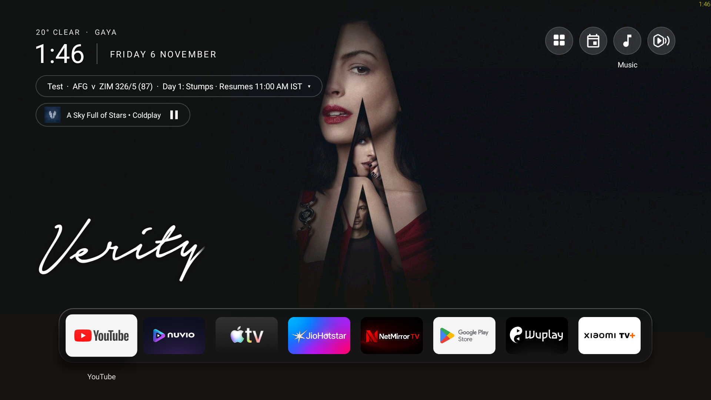 | 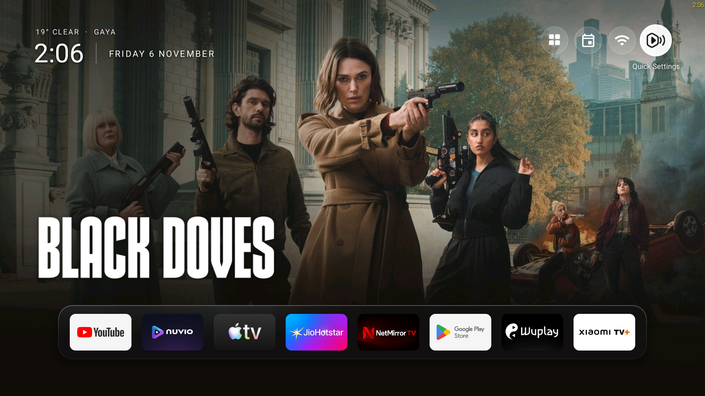 |  |

### 🎬 Movie & TV Discovery

| Trending & Popular Catalogs | For You — Movies | Trailer Playback up to 4K|
| :---: | :---: | :---: |
| 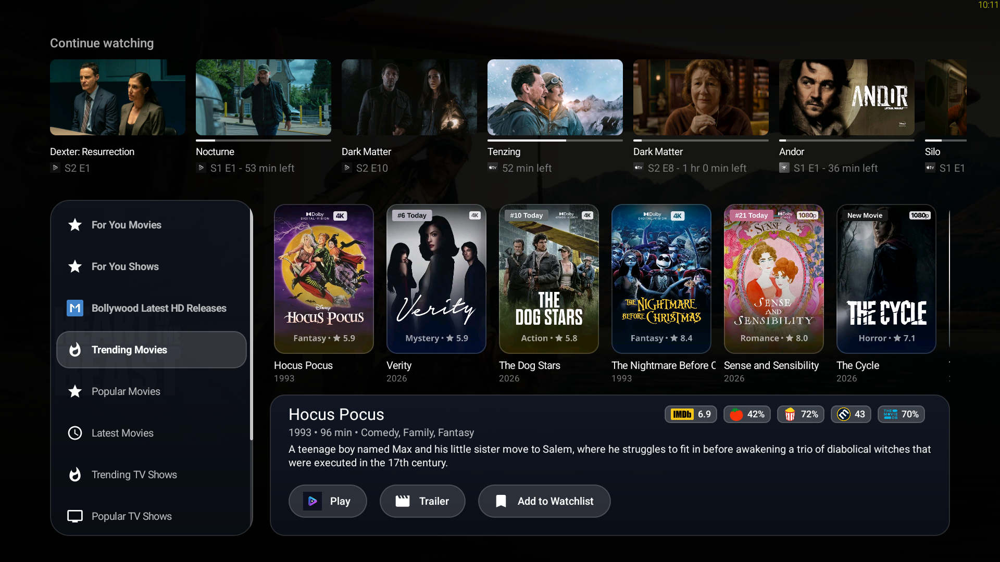 |  | 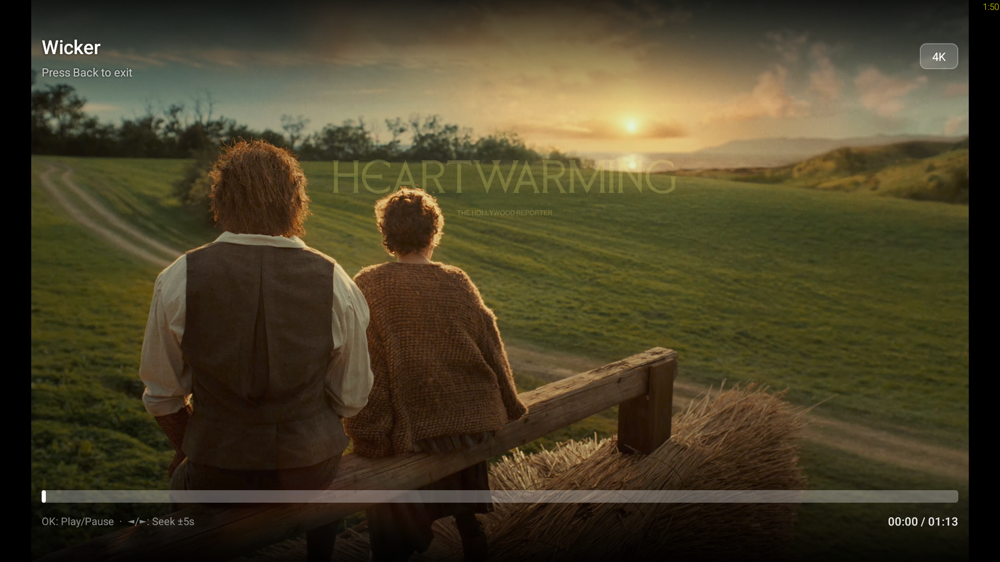 |

### ▶️ Playback Integrations

| Preferred Player Selection | Gemini Search Playback | Catalog Direct Playback |
| :---: | :---: | :---: |
| 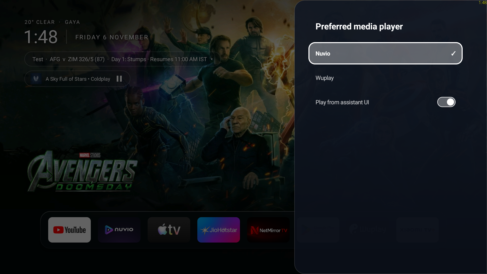 | 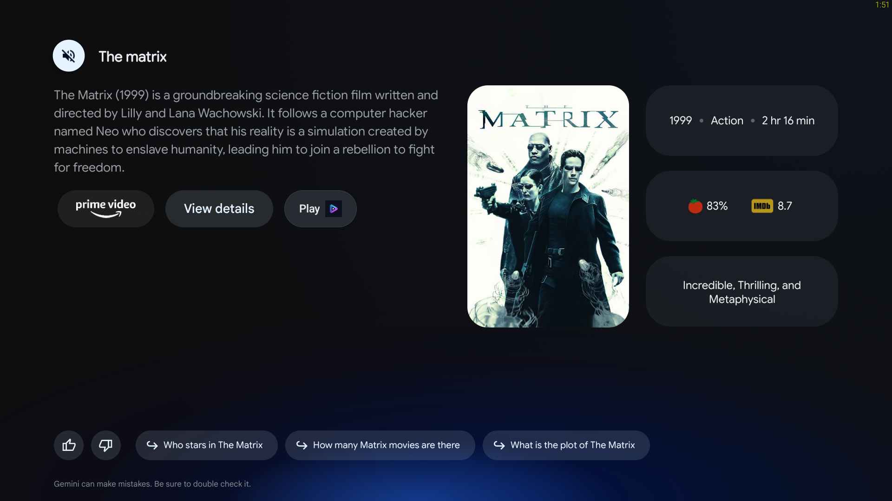   |  |

### 📅 TV Show Calendar

| Your Shows | All Premieres |
| :---: | :---: |
| 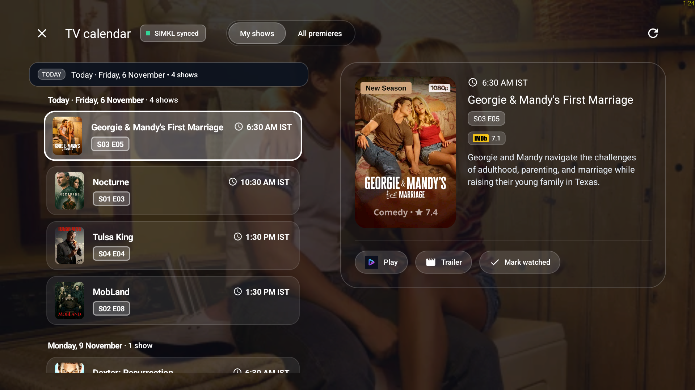 |  |

### 🎵 In-built Music Player

| Music Home & Quick Mixes | Synchronized Lyrics |
| :---: | :---: |
| 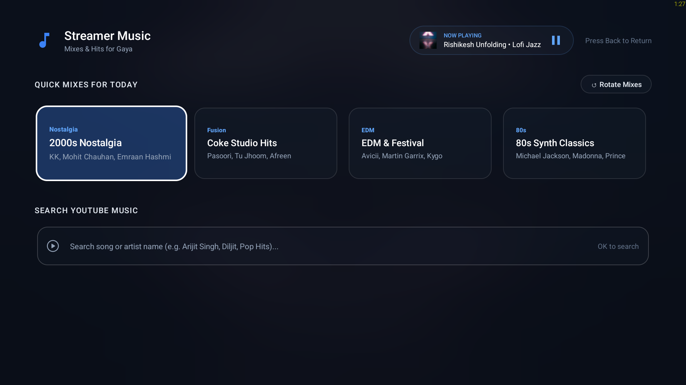 |  |

### 🏏 Live Cricket

Home Screen Live Scores & Match Schedule |
| :---: |
| 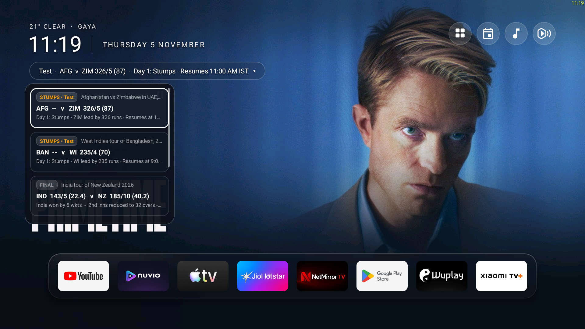 |

### 🖼️ Wallpapers

| Full Cinema | Minimal Logo | Clean Posters |
| :---: | :---: | :---: |
| 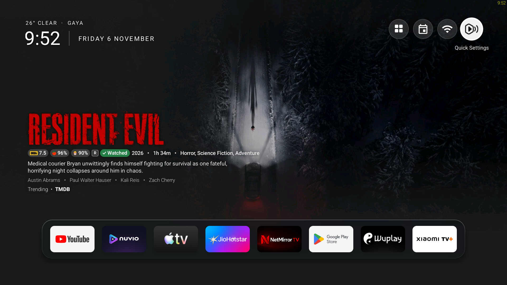 |  | 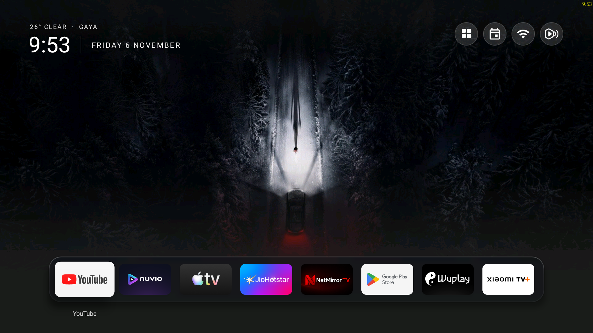 |

### 📁 File Manager & LocalSend

| Built-in File Manager | LocalSend File Transfer | File Selection |
| :---: | :---: | :---: |
|  | 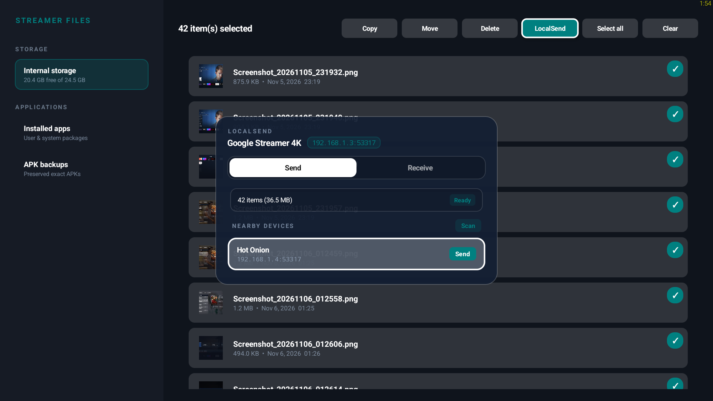 |  |
| Multiple App Transfer | LocalSend Transfer in Progress | Transfer Completed |
| 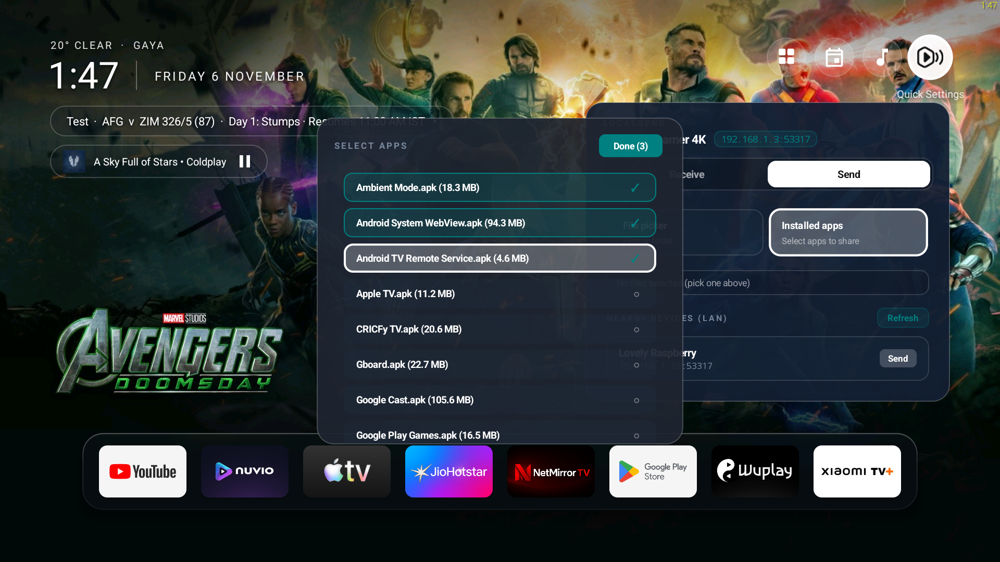 |  |  |

### 🎛️ Remote & Device Controls

| Button Remapper | Button Alias & Press Actions | HDMI Input Selection |
| :---: | :---: | :---: |
| 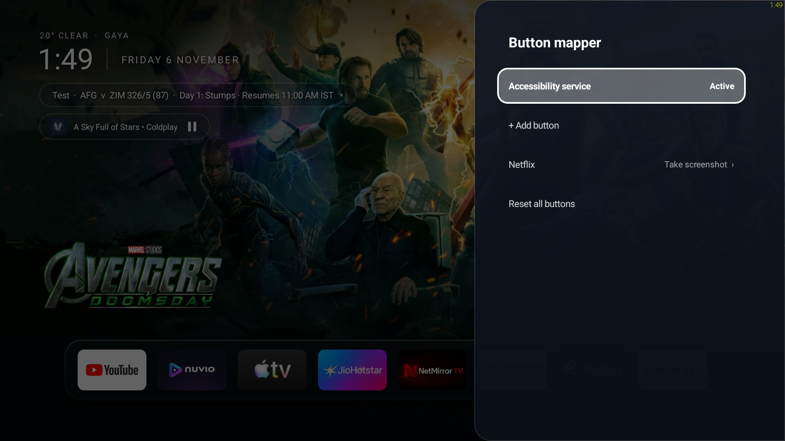 | 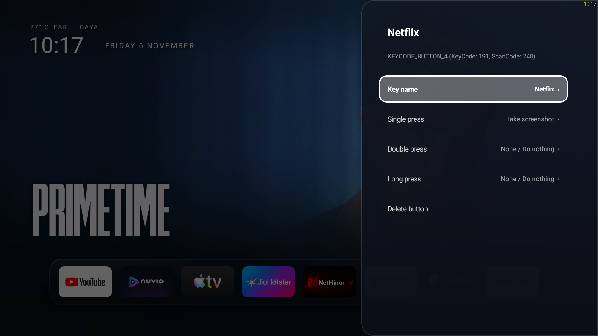 |  |

### ⚙️ Settings, Backup & Updates

| Main Settings | MDBList API Configuration | Backup & Restore |
| :---: | :---: | :---: |
| 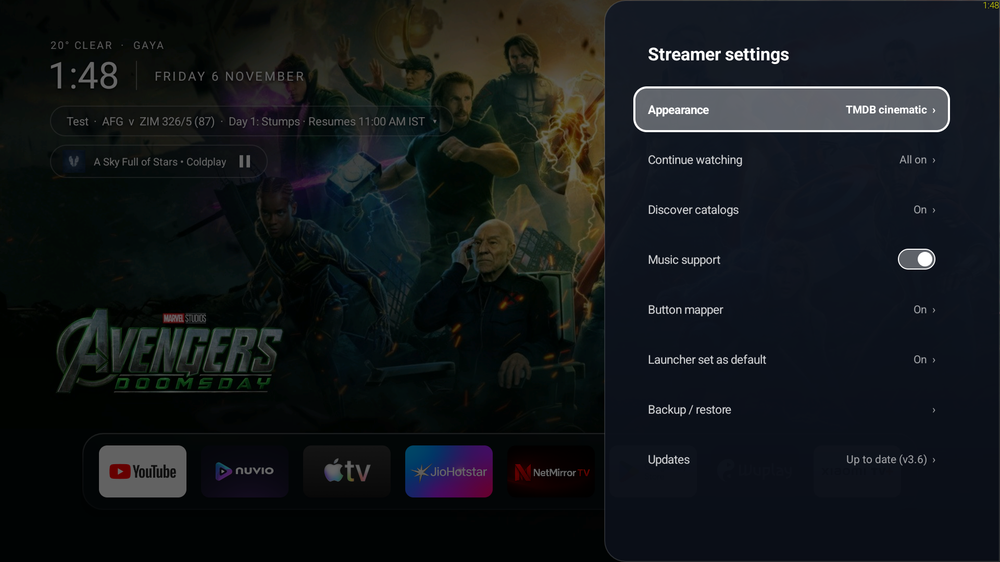 | 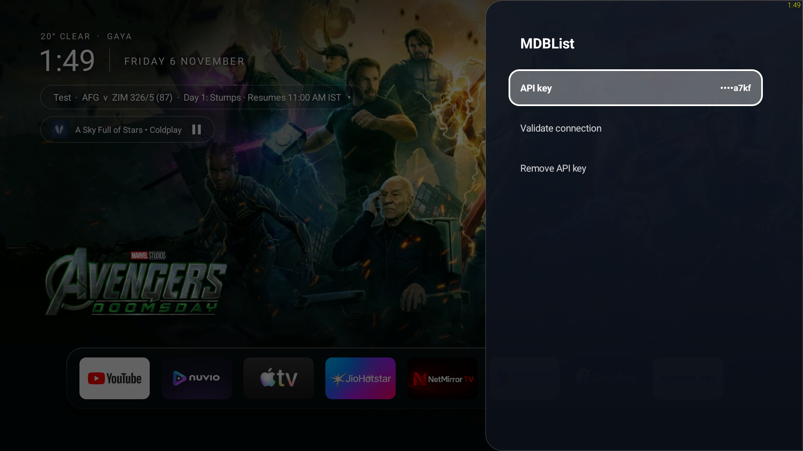 |  |

---

## Key Features

- **Ultra-Light Android TV & Fire TV Launcher**:
  - Integrated date, weather, clock, and optional live **Traffic Meter** (`↑↓` speed / `No internet` pill) with fast pre-cached cold-boot wallpaper and dock startup.
  - Cross-platform **Fire TV / Fire OS** compatibility alongside Android TV & Google TV, including native **atvTools LAN QR ADB Setup** (`RemoteSetupServer`) and Fire TV custom screensaver interception.
  - Liquid-glass app dock (`DockPillView`) with adaptive contrast over dark and light wallpapers, supporting up to **8 apps**, custom icon sizing, app icon tinting, and focus ring accent colors.
  - Compatible with **Projectivy, ADW, Nova, and Lawnchair icon packs** (`Apply icon pack` & long-press `Choose from icon pack`), custom icon uploads, and one-click Projectivy Icon Pack APK installation.
  - Rearrange or remove apps from the dock.
  - Clutter-free home screen option, including controls to hide the cricket score pill.
  - Configurable home screen dimming during a selected time interval.
- **Built-in File Manager & LocalSend v2**:
  - TV-friendly file manager designed for remote D-pad navigation with pure-Kotlin **exFAT / FAT32** USB Mass Storage OTG support and in-app image previews.
  - LocalSend v2 built in with dual HTTP/HTTPS server support, Ethernet/multicast peer discovery, and MediaStore fallback for local wireless transfers.
  - Open LocalSend directly from the File Manager to send and receive files between devices.
- **Streamer Controls & Couch Curfew Parental Controls**:
  - Built-in **Streamer Controls** workspace featuring **Control Hub** (live RAM, network RX delta, speed burst test, and system telemetry updating every 3 seconds), **Running Tasks** (`totalPSS` memory breakdown and background task cleanup), **Quick Presets**, **Activity Explorer**, **My Shortcuts**, and **App Compiler** with Local ADB (`LADB`) elevation.
  - **Screen Time & Data**: Interactive **Hub**, **Table**, and **Trends** views with real `UsageEvents` tracking across `7d`, `30d`, and `366d` history.
  - **Couch Curfew & Kids Mode**: Set daily app limits, bedtime schedules, instant app Lock/Block rules, and a 4-digit PIN. Unlocking once inside **Streamer Controls** keeps the current session unlocked across tabs and LADB controls until exit.
- **Unified 3-Page Navigation & Media Discovery**:
  - Smooth 3-page layout flowing from **Page 1 (Home Dock)** → **Page 2 (All Apps)** → **Page 3 (Discover Catalogs)** with GPU-composited transitions and tuned D-pad scrolling physics (`SmoothTvScrollView`).
  - Interactive discovery header bar combining:
    - **Voice & D-Pad Search**: High-speed search with built-in Voice Search (`android.speech.RecognizerIntent`) and on-screen keyboard filtering.
    - **TV Show Calendar**: Integrated directly into the Page 2 header bar (between Search and Watched toggle) for immediate schedule access; Back and D-pad Home cleanly return to Page 2.
    - **Watched Toggle**: Quick visibility filter pill (`Watched: Shown` / `Watched: Hidden`) for immediate catalog filtering.
    - **Category Filters**: Filter chips for **All**, **Movies**, and **Shows** with smart media format routing.
    - **Catalog Taxonomy & Live Counter**: Inline genre indicator and dynamic title count badge.
    - **Player Selection Pill**: Direct preferred player switcher (Nuvio variants, Stremio, CloudStream, or None with graceful handling).
  - Three-tier sliding taxonomy explorer: Browse genres (Action, Adventure, Comedy, Crime, Sci-Fi, etc.), subgenres / decades, and rich 5-column poster grids with 0% overlap.
  - Live synopsis box, **Director | Cast** filmography popups, and backdrop previews updating dynamically as posters gain focus.
  - 24-hour disk cache and 800ms query LRU cache, completely eliminating cold-start blank screens and navigation lag.
  - Master feature switch under `Streamer settings → Turn features on/off → Discover catalogs Page 2`.
- **Preferred Media Player & Direct Playback**:
  - Choose **Nuvio** (including `com.nuvio.tv`, `com.nuvio.app`, `com.nuvio.tv.lite`, and other installed variants), **Stremio**, **Wuplay**, or **CloudStream** as the preferred external media player.
  - Launch supported titles directly from **Google Gemini**, **Android TV Google Assistant** detail screens (`EntityDetailsActivity`), and **Fire TV / Alexa** details screens with floating **Play** overlays.
  - Launch titles directly from built-in catalogs and Continue Watching.
- **Custom App Icons & Live Video/GIF Wallpapers**:
  - **Custom App Icon Upload**: Upload custom images for any app on the dock or All Apps drawer with support for PNG, JPG, WEBP, and GIF formats (max file size: **6 MB**), or choose directly from installed icon packs.
  - **Video Wallpapers**: Background video loop playback (MP4, MKV, WebM) with hardware-safe RAM thresholds:
    - Devices with **≤ 1.6 GB RAM**: Max video size **35 MB** (1080p max resolution).
    - Devices with **≤ 2.5 GB RAM**: Max video size **55 MB** (1080p max resolution).
    - Devices with **≤ 3.5 GB RAM**: Max video size **75 MB** (up to 4K).
    - Devices with **> 3.5 GB RAM**: Max video size **100 MB** (up to 4K).
  - **Animated GIF Wallpapers**: Native infinite-loop playback for GIF and animated WEBP wallpapers using Android `AnimatedImageDrawable`.
  - Custom photos, folders, and Bing Daily wallpapers render cleanly without any top shadow or haze by default (`Appearance → Photo fade` defaults to **Off**), with raw-image luminance detection adapting clock and top-bar icons automatically.
- **Centralized Feature Controls & Quick Navigation**:
  - Dedicated **Turn features on/off** menu in Main Settings with master switches to toggle **Music**, **Continue watching**, and **Discover catalogs Page 2**.
  - Long-press **Quick Settings** to open Android System Settings directly; top-bar **Wi-Fi** shortcut (when Music is off) opens Android Wi-Fi Settings directly with D-pad focus preserved on return.
- **Hardware HDMI & AV Input Switcher**:
  - Select supported HDMI and AV inputs directly from the launcher.
- **Hardware Remote Button Remapper & Universal Floating Overlays**:
  - Remap supported TV remote buttons with zero-latency, sub-microsecond $O(1)$ key lookup and fail-open dynamic accessibility key filtering.
  - Add custom aliases to make buttons easier to identify, or bind **My Shortcuts** directly in the remapper.
  - Configure independent single-press, double-press, and long-press actions.
  - **Works Anywhere Floating Overlays**: Launch **All Apps** (`AllAppsOverlay`), **Streamer Controls** (`StreamerControlsOverlay`), Quick Settings, Live Cricket Scores, full LocalSend file transfer, Music HUD, Streamer Settings, or App Dock directly over any running app or video player (YouTube, Netflix, etc.) without leaving your content or interrupting playback.
  - **Categorized Actions**: Streamer features cleanly organized into **Works anywhere** and **Works from homescreen** sections.
- **MDBList & Phone QR Setup**:
  - Connect using your personal MDBList API key and add private, dynamic, or static lists with automatic personal list syncing.
  - **Scan QR from Phone**: Configure **Cricket**, **MDBList**, and public catalogs right from your smartphone browser without typing API keys on your TV remote.
- **Backup & Restore v4**:
  - Export and restore launcher settings, custom folders/shortcuts, icon preferences, and API keys safely across app restarts.
- **Over-the-Air Updates**:
  - Check for and install launcher updates without manually downloading each release.
- **Low-Memory & High-Smoothness Engineering**:
  - Lightweight interface, GPU-baked Aurora live wallpaper textures, `720p`/`RGB_565` static wallpaper optimization, **TMDB "On home visit"** backdrop rotation, customizable **TMDB synopsis font size** (`Normal` / `Bigger`), and asynchronous data handling tuned for entry-level Android TV and Fire TV hardware.

---

## ⚡ Resource & Performance Profile (RAM & CPU)

Streamer Launcher is strictly engineered for low-memory, entry-level Android TV and Google TV hardware (benchmarked on a physical **MediaTek MT5867 Quad-Core with only ~929 MB Total RAM on Android 11**):

### Before vs After v4.2.1 Deep Optimizations

| Operating State | Baseline (v4.2) Total RAM | Optimized (v4.2.1) Total RAM | Java Heap (v4.2.1) | Graphics & Native (v4.2.1) | CPU Usage | Real-World Scenario |
| :--- | :---: | :---: | :---: | :---: | :---: | :--- |
| **Idle / Cold Start** | ~48 MB | **~40 MB** *(16.7% ↓)* | ~4.8 MB | ~12.6 MB | **0.0% – 0.5%** | Fresh launch, sitting idle on the Home dock, background threads completely asleep. |
| **Normal Active Navigation** | ~65 MB | **~73 MB** | ~6.7 MB | ~37.0 MB | **0% – 8%** | Browsing home apps, Page 2 catalogs, opening item context menus, and scrolling recommendations. |
| **Peak / Max Workload** | ~108 MB | **~83 MB** *(23.1% ↓)* | ~9.3 MB | ~44.5 MB | **15% – 25%** | All 8 catalog rows loaded, live cricket score ticker scrolling, YouTube Music streaming in the background, TV Calendar with airing posters open, and 1080p wallpaper rotation. |

### Architectural Highlights
- **v4.3 Frame Pacing & Render Pipeline Optimization**: Pre-baking Aurora textures, removing unfocused offscreen elevation layers, lazy-loading drawables, deferring off-screen Page 2 work, and pausing off-screen live wallpaper rendering reduced measured TV Home + Dock + Page 2 janky frames from **94.42% (`558/591`)** down to **10.32% (`35/339`)** (median frame time **38 ms → 7 ms**).
- **Zero Idle Drain (Reactive, Not Polling)**: Completely event-driven architecture with zero background timer loops or busy-wait polling. When inactive, CPU drops to **0%**.
- **Streaming JSON & Request Deduplication**: Multi-megabyte SIMKL TV calendar and watchlist feeds use a streaming parser (`StreamingJsonReader`) with single-flight request coalescing (`fetchWatchlistCoalesced`), eliminating redundant JSON memory allocations and duplicate network bursts.
- **Main-Thread Decoupling**: Item context menus and watched caches are warmed asynchronously in the background. Opening menus takes **<1 ms** with **0 ms** synchronous disk I/O on the Android main thread.
- **Safe for Sub-1GB RAM Devices**: Stays well below the Android TV 192 MB low-memory threshold even under maximum concurrent load, guaranteeing zero system lag or background app evictions.

---

## Technical Architecture

```
+-------------------------------------------------------------------------------+
|                               Streamer Launcher                               |
+---------------------------------------+---------------------------------------+
|              Data Layer               |               UI Layer                |
|  - TMDB API & Multi-Rating Engine     |  - Lightweight Android View Hierarchy |
|  - MDBList & SIMKL Watchlists Engine  |  - SnapScrollView (60fps D-pad Paging)|
|  - SIMKL Taste Profile AI Engine      |  - Floating Quick Settings Glass Panel|
|  - Streaming TV Calendar (16-day Win) |  - Streamer Music Player & Visualizer |
|  - YouTube Music & Audio Extractor    |  - Status Bar Now Playing Pill Widget |
|  - Single-Flight Request Coalescing   |  - DockPillView (Frosted Blur Glass)  |
|  - LocalSend LAN Engine (v2 Protocol) |  - Ambient Dimmer Alpha Controller    |
|  - Streamer Files Manager & Installer |  - Dynamic Backdrop & Wallpaper Sync  |
|  - Backup & Restore JSON Engine       |  - Live Cricket Ticker Pill & Overlay |
|  - Android WatchNext Provider         |  - Media Player Relay Accessibility   |
|  - CricketData Live Score Engine      |  - TV Calendar Modal & Timeline View  |
|  - Button Mapper Input Handler        |  - LocalSend Modal & File Transfer UI |
|  - SurfaceFlinger Hardware Screenshot |  - Hardware HDMI / AV Input Switcher  |
+---------------------------------------+---------------------------------------+
|                          Hardware & Media Pipeline                            |
|  - Media3 ExoPlayer 1.5.1 (1440p/1080p Video + YouTube Audio Stream Mux)      |
|  - Android Jetpack ProfileInstaller (Zero-Permission AOT Machine Compilation) |
|  - RGB_565 Decoded Bitmaps & Texture Recycling (Zero GC Stalls, Low Heap)     |
|  - Asynchronous Background Watched Cache Warmup (0 ms Main-Thread Disk I/O)   |
|  - SurfaceFlinger HardwareBuffer Direct Capture (Android 14 API 30+ Compliant)|
|  - R8 Full-Mode Minification & Multi-Pass Resource Shrinking (3.8 MB APK)     |
+-------------------------------------------------------------------------------+
```

---

## TV Remote Navigation Guide

| Action | Remote Key / Gesture |
| :--- | :--- |
| **Move Focus** | <kbd>Up</kbd> <kbd>Down</kbd> <kbd>Left</kbd> <kbd>Right</kbd> Directional Pad (D-pad) |
| **Launch App / Media** | <kbd>OK</kbd> / <kbd>Enter</kbd> (Center Button) |
| **Switch Pages** | <kbd>Down</kbd> from the dock opens **All Apps** (Page 2), continuing into **Discover Catalogs** (Page 3) |
| **Open Top Bar / Quick Settings** | <kbd>Up</kbd> from the dock moves to the top bar and **Quick Settings** (cyclic D-Pad tile navigation) |
| **Now Playing Shortcut** | Select the Now Playing pill in the status bar to jump directly into the music player |
| **Music Player Controls** | <kbd>OK</kbd> to Play/Pause, <kbd>Left</kbd> / <kbd>Right</kbd> on seekbar to scrub by 5s, shuffle toggle, track queue |
| **Open TV Calendar** | Select the Calendar icon from the top bar |
| **LocalSend Transfer** | Select the LocalSend icon from the top bar to send/receive files |
| **Streamer Files** | Select the File Manager icon from the dock or top bar to browse files/APKs |
| **HDMI / AV Input** | Select an HDMI or AV input icon to switch TV hardware source |
| **Item Context Menu** | Long-press <kbd>OK</kbd> on any catalog poster for instant (<1 ms) details and SIMKL status |
| **Quick Play / Trailer** | Highlight movie poster -> Press <kbd>Up</kbd> to access Play and Trailer buttons |
| **App Management** | Long-press <kbd>OK</kbd> on any dock app to rearrange or hide |
| **Back / Exit Modal** | <kbd>Back</kbd> key closes music player, trailers, search dialogs, calendar, and settings |

---

## Installation

### Option 1: Direct APK Download
Download the latest pre-compiled release from the [Releases Page](https://github.com/raviprakashji/Streamer-launcher-release/releases/latest) (see [CHANGELOG.md](CHANGELOG.md) for release notes):
- **Streamer.launcher_v4.4.1.apk** (5.1 MB)

### Option 2: Install via ADB
```bash
# 1. Connect to your TV over Wi-Fi
adb connect <your-tv-ip>:5555

# 2. Install the APK
adb install -r "Streamer.launcher_v4.4.1.apk"
```

### Grant Secure Settings Permission (Required for Certain System-Level Features)

Streamer Launcher uses Android's `WRITE_SECURE_SETTINGS` permission for certain system-level features. Android does not allow an ordinary app to grant this permission to itself, so grant it once from a computer connected to your TV through ADB:

```bash
adb shell pm grant com.streamer.launcher android.permission.WRITE_SECURE_SETTINGS
adb shell cmd package set-home-activity com.streamer.launcher/.MainActivity
```

**Steps:**
1. Enable **Developer options** and **USB debugging** or **Wireless debugging** on your Android TV.
2. Connect to the TV from your computer using ADB.
3. Run the command above.
4. Restart Streamer Launcher if the affected feature does not immediately detect the permission.

**Note:** This permission can be granted through ADB without root access. It is a privileged Android permission, not an Accessibility Service enablement step; granting it does not turn on an Accessibility Service.

---

## License

This project is licensed under the **GNU General Public License v3.0 (GPL-3.0)**. See the [LICENSE](LICENSE) file for complete details.
