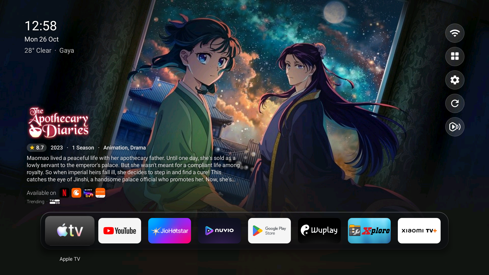
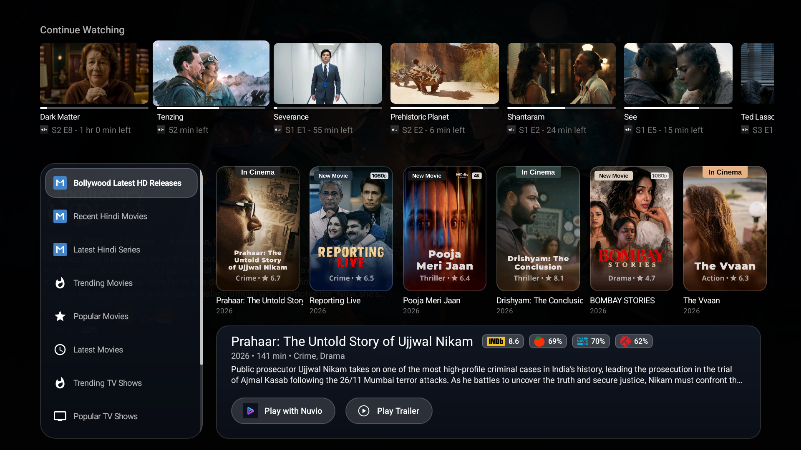
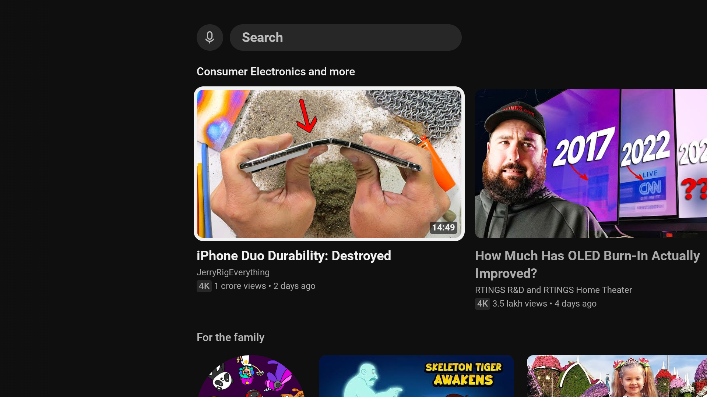
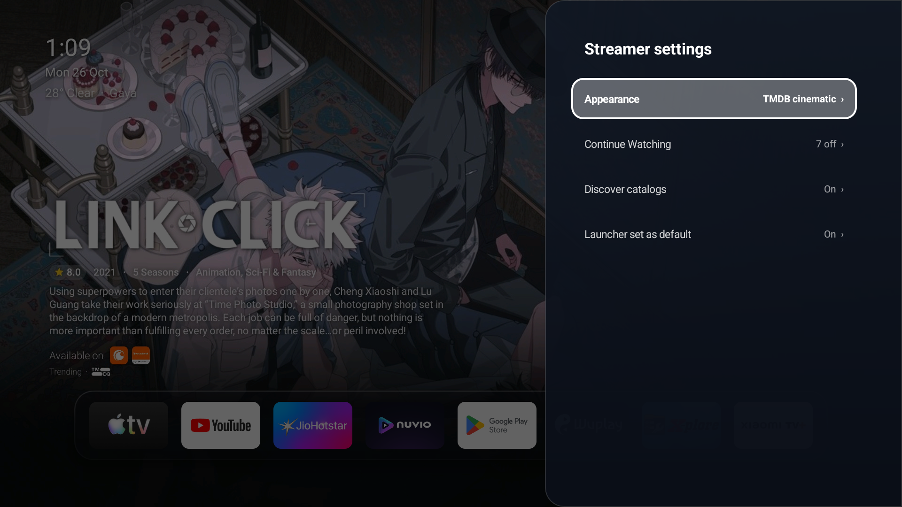
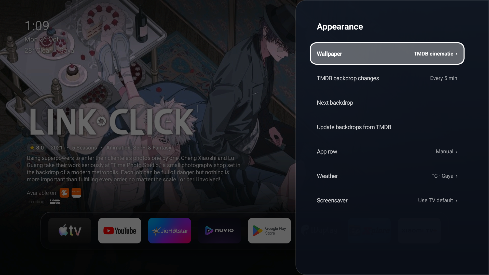
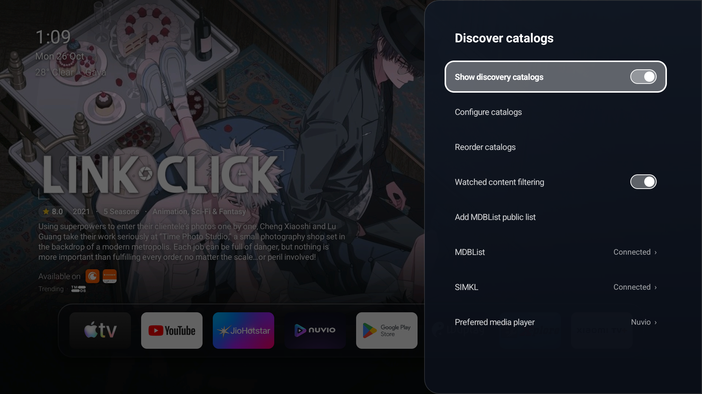

# Streamer Launcher

<p align="center">
  <strong>An ultra-fast, minimal, and elegant home screen engineered specifically for Android TV and Google TV.</strong>
</p>

<p align="center">
  <a href="https://github.com/raviprakashji/Streamer-launcher/releases/latest"></a>
  
  
  <a href="https://github.com/raviprakashji/Streamer-launcher/actions"></a>
  
  <a href="LICENSE"></a>
</p>

---

## Product Showcase

<p align="center">
  <a href="https://github.com/raviprakashji/Streamer-launcher/releases/download/v1.0/streamer-demo.mp4">
    
  </a>
</p>

<p align="center">
  <em><strong><a href="https://www.youtube.com/watch?v=ZTTD3AxTKcA">Click here to watch the HD Video Demo (YouTube)</a></strong></em>
</p>

### Core Interface

| Home Screen (Page 1) | Discover Catalogs (Page 2) |
| :---: | :---: |
|  |  |
| *Streamlined glass dock with adaptable icons, clock, and live weather.* | *TMDB Trending rows, ratings aggregator, and dynamic backdrop sync.* |

| High-Definition Trailer Streaming | Streamer Settings Main Menu |
| :---: | :---: |
|  |  |
| *Built-in ExoPlayer 1440p / 1080p in-app trailer player with scrub bar and HD badge.* | *AMOLED dark frosted settings menu with fast categorized navigation.* |

---

### Settings and Configuration Submenus

| Appearance Submenu | Continue Watching Submenu |
| :---: | :---: |
|  |  |
| *Wallpapers (Rockies Day/Dusk, Pure black, TMDB cinematic), photo fade, and rotation timer.* | *Filter per-app sources and restore hidden shows with package icon badges.* |

<p align="center">
  <strong>Discover Catalogs Submenu</strong>
  <br>
  
  <br>
  <em>Toggle discovery catalogs, connect MDBList and SIMKL watchlists, and configure preferred media players.</em>
</p>

---

## Key Features

- **Streamer Music Integration (YouTube Music Engine)**:
  - Full-featured YouTube Music audio streaming engine built on Media3 ExoPlayer with background playback and dynamic waveform visualization.
  - Regional mixes and curated playlists discovery directory on Page 1, plus instant music search with debounced queries and result suggestions.
  - Status bar Now Playing pill widget with smooth marquee track title, album artwork, and direct return shortcut.
  - Interactive playback controls: seekbar scrub with remote D-pad (<kbd>Left</kbd> / <kbd>Right</kbd> by 5s), shuffle toggle, and track queue management.
  - Streaming disconnect detection with warning prompt to reconnect internet during streaming interruption.
- **Floating Quick Settings Panel**:
  - Compact frosted glass floating panel positioned directly beneath the Quick Settings top-bar action with full D-Pad focus trapping.
  - Live Now Playing tile within Quick Settings showing real-time playback progress bar, duration timestamps, and one-click navigation to the music player.
  - Exact D-Pad cyclic navigation matrix with continuous snake wrapping across tiles (WiFi, LocalSend, Inputs, Streamer Settings, Files, Music).
- **SIMKL Taste Profile & Native "For You" Recommendations**:
  - On-device multi-factor recommendation engine calculating decaying genre affinity, release decade distribution, and language preferences.
  - Dynamically synthesizes personalized "For You: Movies" and "For You: TV Shows" catalogs directly onto Page 2.
  - Seamless in-place SIMKL watchlist add/remove toggle with zero UI disruption.
- **Streaming SIMKL TV Calendar & Premiere Schedule**:
  - Memory-efficient streaming JSON parser (`StreamingJsonReader`) processing large multi-megabyte calendar feeds with bounded memory allocation.
  - Rolling 16-day windowing (-1 to +14 days) and two-day global timezone margin filter ensuring airing badge synchronization across any local timezone.
  - Instant 0 ms view loading with persistent disk caching and downsampled RGB_565 poster decoding.
  - Genuine Premieres filtering: TMDb season debut verification filters out foreign re-runs, repeats, and catalog noise.
- **Live Cricket Scores & Match Ticker**:
  - Real-time CricketData API integration with live score pill on the status bar and full scorecard overlay.
  - Automated match format detection (ODI, T20, Test) with live ball-by-ball and over updates.
- **LocalSend High-Speed File Transfer**:
  - Integrated LocalSend (v2 protocol compatible) wireless LAN file transfer directly on Android TV.
  - Effortlessly send and receive APKs, videos, subtitles, and documents to/from phones, tablets, and PCs without third-party apps or cloud intermediaries.
- **Streamer Files (Leanback File Manager & Direct APK Installer)**:
  - Purpose-built Android TV file manager designed specifically for remote D-pad navigation.
  - Browse internal storage and connected USB flash drives, inspect directories, and install APK packages with background install status feedback.
- **Direct Hardware Screenshot Capture Engine (Android 14 & Google TV Streamer)**:
  - Bypasses absent SystemUI screenshot services on Google TV Streamer (Android 14) by capturing raw display frames directly from `SurfaceFlinger` hardware buffers via `AccessibilityService.takeScreenshot(Display.DEFAULT_DISPLAY, ...)` (API 30+).
  - Converts raw `HardwareBuffer` to Bitmap and writes to `Pictures/Screenshots` via `MediaStore` with on-screen confirmation toast.
- **Hardware HDMI & AV Input Switcher**:
  - Dedicated input source switcher supporting HDMI 1–4 and Composite AV.
  - Instantly switch TV hardware inputs directly from the home screen dock, top navigation bar, or Quick Settings panel.
- **Hardware Remote Button Mapper**:
  - Customize and remap TV remote control buttons (Netflix, Prime Video, Guide, Home, etc.) to launch Streamer Launcher or any preferred TV application/action.
  - Cleaned up Leanback TV actions (Home, Back, Power menu, Take screenshot, Sleep display) with direct intent fallbacks.
- **Intelligent Trailer Streaming & Geo-Restriction Fallbacks**:
  - Multi-tier YouTube stream resolution engine with automatic watch config refresh and fallback candidate discovery (TMDB & YouTube search) for geo-blocked or region-restricted trailers.
  - Seamless in-app ExoPlayer trailer playback supporting up to 1440p / 1080p with resolution badge, scrubbable progress bar, and instant play/pause.
- **Ambient Homescreen Dimming & Component Control**:
  - Customizable idle dimmer under Streamer Settings -> Appearance -> Dim homescreen components (choices: 5s, 10s, 15s, 30s, 45s, 1m, 2m, 5m, 15m, or Off).
  - Smoothly fades the dock, clock, weather, and top navigation bar to transparent during inactivity, transforming the TV into a clean art canvas.
  - Independent toggles for Dim Cricket score and Dim Now Playing with fixed-anchor layout preservation.
  - Instantly wakes up upon any remote D-pad input or touch interaction.
- **MDBList Private & Dynamic User Lists Integration**:
  - Automatic import of user lists (dynamic, linked, and static) from connected MDBList accounts with on-device API resolution and deduplication.
- **Zero-I/O Context Menu & Request Coalescing Pipeline**:
  - Completely decoupled SIMKL watched-status inspection from UI-thread JSON disk parsing, moving watched cache loading to asynchronous background warmup.
  - Reduced context-menu opening latency from 60–800 ms to instantaneous (<1 ms / 0 ms main-thread I/O).
  - Single-flight request coalescing (`fetchWatchlistCoalesced` and `fetchWatchedData`) eliminating duplicate network queries and multi-megabyte downloads.
- **Backup and Restore System**:
  - Complete configuration export and import under Streamer Settings -> Backup / Reset.
  - Backs up and restores dock ordering, wallpaper preferences, screensaver modes, weather locations and units, live CricketData API key, Homescreen Dimming timeouts, and SIMKL credentials.
  - Seamlessly re-applies preferences across device re-installations while matching currently installed TV applications.
- **Zero-Permission AOT Compilation**:
  - Bundles Android Jetpack Baseline Profiles (androidx.profileinstaller) to compile DEX bytecode to native machine instructions directly upon installation and update.
  - Requires zero Developer Options, no USB Debugging, and no Root privileges.
- **Media Player Relay and Voice Search Disambiguation**:
  - Overlays a direct "Watch in [Player]" button on Google Assistant search result pages and TV detail screens.
  - Intelligent media title resolution ranking that correctly prioritizes exact title and year matches.
- **TMDB Discover Catalogs**:
  - Browse trending movies, popular series, top rated titles, and curated genres.
  - Dynamic synopsis cards with multi-platform ratings (IMDb, TMDb, Rotten Tomatoes, Trakt, Metacritic).
- **Preferred Media Player Launcher**:
  - One-click launch to your favorite external video player: Nuvio, Nova Player, Stremio, Just Player, Kodi, VLC, MX Player, or prompt on every play.
- **Continue Watching Aggregator**:
  - Resumes ongoing media from Android TV Watch Next and supported media applications.
  - Hidden show management with app icon badges and automatic pruning of uninstalled apps.
- **Ultra-Lean and Memory Optimized (3.8 MB APK)**:
  - Sub-4MB APK footprint with instant cold boot.
  - Deep memory trim: 48 MB cold startup PSS, 65 MB normal navigation, and safe sub-110 MB peak workload on ~929 MB RAM devices.
  - Deadlock-free background executor architecture for smooth, stall-free operation on low-RAM TV hardware.

---

## ⚡ Resource & Performance Profile (RAM & CPU)

Streamer Launcher is strictly engineered for low-memory, entry-level Android TV and Google TV hardware (benchmarked on a physical **MediaTek MT5867 Quad-Core with only ~929 MB Total RAM on Android 11**):

| Operating State | Total RAM (PSS) | Java Heap | Graphics & Native | CPU Usage | Real-World Scenario |
| :--- | :---: | :---: | :---: | :---: | :--- |
| **Idle / Cold Start** | **~48 MB** | ~4.4 MB | ~17.9 MB | **0.0% – 0.5%** | Fresh launch, sitting idle on the Home dock, background threads completely asleep. |
| **Normal Active Navigation** | **~65 MB** | ~7.1 MB | ~31.6 MB | **0% – 8%** | Browsing home apps, Page 2 catalogs, opening item context menus, and scrolling recommendations. |
| **Peak / Max Workload** | **~108 MB** | ~32.8 MB | ~55.2 MB | **15% – 25%** | All 8 catalog rows loaded, live cricket score ticker scrolling, YouTube Music streaming in the background, TV Calendar with airing posters open, and 1080p wallpaper rotation. |

### Architectural Highlights
- **Zero Idle Drain (Reactive, Not Polling)**: Completely event-driven architecture with zero background timer loops or busy-wait polling. When inactive, CPU drops to **0%**.
- **Streaming JSON & Request Deduplication**: Multi-megabyte SIMKL TV calendar and watchlist feeds use a streaming parser (`StreamingJsonReader`) with single-flight request coalescing (`fetchWatchlistCoalesced`), eliminating redundant JSON memory allocations and duplicate network bursts.
- **Main-Thread Decoupling**: Item context menus and watched caches are warmed asynchronously in the background. Opening menus takes **<1 ms** with **0 ms** synchronous disk I/O on the Android main thread.
- **Safe for Sub-1GB RAM Devices**: Stays well below the Android TV 192 MB low-memory threshold even under maximum concurrent load, guaranteeing zero system lag or background app evictions.

---

## Technical Architecture

```
+-------------------------------------------------------------------------------+
|                               Streamer Launcher                               |
+---------------------------------------+---------------------------------------+
|              Data Layer               |               UI Layer                |
|  - TMDB API & Multi-Rating Engine     |  - Lightweight Android View Hierarchy |
|  - MDBList & SIMKL Watchlists Engine  |  - SnapScrollView (60fps D-pad Paging)|
|  - SIMKL Taste Profile AI Engine      |  - Floating Quick Settings Glass Panel|
|  - Streaming TV Calendar (16-day Win) |  - Streamer Music Player & Visualizer |
|  - YouTube Music & Audio Extractor    |  - Status Bar Now Playing Pill Widget |
|  - Single-Flight Request Coalescing   |  - DockPillView (Frosted Blur Glass)  |
|  - LocalSend LAN Engine (v2 Protocol) |  - Ambient Dimmer Alpha Controller    |
|  - Streamer Files Manager & Installer |  - Dynamic Backdrop & Wallpaper Sync  |
|  - Backup & Restore JSON Engine       |  - Live Cricket Ticker Pill & Overlay |
|  - Android WatchNext Provider         |  - Media Player Relay Accessibility   |
|  - CricketData Live Score Engine      |  - TV Calendar Modal & Timeline View  |
|  - Button Mapper Input Handler        |  - LocalSend Modal & File Transfer UI |
|  - SurfaceFlinger Hardware Screenshot |  - Hardware HDMI / AV Input Switcher  |
+---------------------------------------+---------------------------------------+
|                          Hardware & Media Pipeline                            |
|  - Media3 ExoPlayer 1.5.1 (1440p/1080p Video + YouTube Audio Stream Mux)      |
|  - Android Jetpack ProfileInstaller (Zero-Permission AOT Machine Compilation) |
|  - RGB_565 Decoded Bitmaps & Texture Recycling (Zero GC Stalls, Low Heap)     |
|  - Asynchronous Background Watched Cache Warmup (0 ms Main-Thread Disk I/O)   |
|  - SurfaceFlinger HardwareBuffer Direct Capture (Android 14 API 30+ Compliant)|
|  - R8 Full-Mode Minification & Multi-Pass Resource Shrinking (3.8 MB APK)     |
+-------------------------------------------------------------------------------+
```

---

## TV Remote Navigation Guide

| Action | Remote Key / Gesture |
| :--- | :--- |
| **Move Focus** | <kbd>Up</kbd> <kbd>Down</kbd> <kbd>Left</kbd> <kbd>Right</kbd> Directional Pad (D-pad) |
| **Launch App / Media** | <kbd>OK</kbd> / <kbd>Enter</kbd> (Center Button) |
| **Switch Pages** | <kbd>Down</kbd> from dock transitions smoothly to Page 2 (Discover Catalogs) |
| **All Apps Shortcut** | Press <kbd>Up</kbd> from anywhere in the app dock to focus the All Apps icon |
| **Open Quick Settings** | Select the Quick Settings icon from the top bar (cyclic D-Pad tile navigation) |
| **Now Playing Shortcut** | Select the Now Playing pill in the status bar to jump directly into the music player |
| **Music Player Controls** | <kbd>OK</kbd> to Play/Pause, <kbd>Left</kbd> / <kbd>Right</kbd> on seekbar to scrub by 5s, shuffle toggle, track queue |
| **Open TV Calendar** | Select the Calendar icon from the top bar |
| **LocalSend Transfer** | Select the LocalSend icon from the top bar to send/receive files |
| **Streamer Files** | Select the File Manager icon from the dock or top bar to browse files/APKs |
| **HDMI / AV Input** | Select an HDMI or AV input icon to switch TV hardware source |
| **Item Context Menu** | Long-press <kbd>OK</kbd> on any catalog poster for instant (<1 ms) details and SIMKL status |
| **Quick Play / Trailer** | Highlight movie poster -> Press <kbd>Up</kbd> to access Play and Trailer buttons |
| **App Management** | Long-press <kbd>OK</kbd> on any dock app to rearrange or hide |
| **Back / Exit Modal** | <kbd>Back</kbd> key closes music player, trailers, search dialogs, calendar, and settings |

---

## Installation

### Option 1: Direct APK Download
Download the latest pre-compiled release from the [Releases Page](https://github.com/raviprakashji/Streamer-launcher/releases/latest):
- **Streamer.launcher_v3.6.1.apk** (3.9 MB)

### Option 2: Install via ADB
```bash
# 1. Connect to your TV over Wi-Fi
adb connect <your-tv-ip>:5555

# 2. Install the APK
adb install -r "Streamer.launcher_v3.6.1.apk"
```

---

## Building from Source

### Prerequisites
- **JDK 17** (Temurin or OpenJDK recommended)
- **Android SDK** (API Level 36, Build Tools 34.0.0)

### Build Commands
```bash
# Clone the repository
git clone https://github.com/raviprakashji/Streamer-launcher.git
cd Streamer-launcher

# Run unit tests
./gradlew test

# Compile release APK
./gradlew assembleRelease
```
The compiled APK will be located at:
`app/build/outputs/apk/release/Streamer.launcher_v3.6.1.apk`

---

## Changelog

### v3.6
- **IMDb Quality Verification Gate**: Dual-threshold IMDb rating verification gate for personalized "For You: Movies" and "For You: TV Shows" catalogs, ensuring high quality recommendations with persistent disk caching and OpenAPI-aligned batch coalescing.
- **Global Music Catalog & Personalization**: Expanded global music directory to 24 diverse playlists across international genres, coupled with automatic weather location detection (`geo_city` / `geo_country`) to serve global mixes and search hints outside India.
- **Streamer Music Focus Containment**: Eliminated remote navigation crashes caused by focus escapes (DPAD UP / DPAD LEFT) via strict focus trapping, non-focusable background containers, and defensive key rescue guards.
- **Cricket Settings Reordering & Key Gating**: Reordered Cricket settings (API key -> Toggle -> Refresh) and enforced strict validation gating, disabling toggling and manual refresh until a valid CricketData key is verified.
- **Homescreen Dock Stability**: Eliminated homescreen layout flicker and dock displacement on cricket score toggle changes via synchronous layout measurement (`syncHomeGapWithTopBar`).
- **Streamer Files Scroll Offset Retention**: Fixed folder navigation jumping in internal storage by recording and restoring exact scroll position and pixel offsets (`FolderNavState`) upon navigating back.
- **Changelog Navigation & Download Progress Polish**: Standalone focusable and scrollable changelog view with decoupled download progress bar and bottom-anchored update action.

### v3.5
- **Streaming SIMKL TV Calendar Parser**: Memory-efficient streaming JSON parser (`StreamingJsonReader`) processing multi-megabyte calendar feeds with bounded allocation, rolling 16-day windowing (-1 to +14 days), and two-day global timezone margin filter ensuring airing badge synchronization across any local timezone.
- **Consolidated Watchlist Request Engine**: Single-flight request coalescing (`fetchWatchlistCoalesced`) eliminating duplicate concurrent queries, mathematical task isolation by account, session generation, media type, and status, and explicit empty-watchlist (`[]`) disk caching.
- **Watched-Data Sync Single-Flight Coalescing**: Coalesced concurrent full watched-data synchronization requests (`fetchWatchedData`) under `publicationLock`, preventing simultaneous multi-endpoint network bursts (~2.8 MB each).
- **Zero-I/O Context-Menu Watched Status**: Decoupled SIMKL watched-status inspection from UI-thread JSON disk parsing, moving watched cache loading to asynchronous background warmup (<1 ms / 0 ms main-thread I/O).
- **Cross-Account State Leakage & Disconnect Cleanup**: Automated purge of `simkl_user_shows.json` from disk upon account logout or disconnect, and late asynchronous write protection preventing stale publication.
- **Low-Memory Hardening**: Proactive memory-pressure trimming (`TRIM_MEMORY_RUNNING_CRITICAL`), guarded bitmap recycling, cold startup Total PSS reduced to 48.4 MB on ~929 MB RAM devices.

### v3.4
- **Streamer Music Integration**: Full-featured YouTube Music audio streaming engine using Media3 ExoPlayer with background playback and dynamic waveform visualization. Regional mixes, curated playlists, instant music search with suggestions, and status bar Now Playing pill widget with smooth marquee track title and album artwork.
- **Floating Quick Settings Panel**: Compact frosted glass floating panel positioned directly beneath the Quick Settings top-bar action with full D-Pad focus trapping, live Now Playing tile with real-time playback progress bar, duration timestamps, and cyclic navigation matrix.
- **Restructured Homescreen Dimming Preferences**: Dedicated subpage under Streamer Settings -> Appearance -> Dim homescreen components with independent toggles for Dim Cricket score and Dim Now Playing, fixed-anchor layout preservation, and expanded dim timeout durations (added 45 sec).
- **Navigation Polish**: Seamless back navigation restoring focus to Quick Settings, eliminated visual app dock shift when exiting music playback directly via the Home button.

### v3.3
- **MDBList Dynamic & User Lists Sync**: Full on-device integration with private and dynamic MDBList user lists, automatically importing user catalogs with resilient URL resolution and deduplication.
- **Top Bar Layout & Visual Navigation Order**: Modernized homescreen top bar ordering with All apps, Calendar, and System Settings permanently visible, collapsible secondary actions, and smooth sequential DPAD traversal.
- **Input Action Header**: Renamed homescreen HDMI button and inputs header to "Input".
- **Discover Catalogs Subpage Optimization**: Streamlined discovery settings hierarchy, locating "Play from assistant UI" exclusively inside Preferred media player and watched content filtering under SIMKL.
- **Catalog Overscroll & Viewport Stability**: Hardened `HomeScrollView` and `catalogsRailScroll` nested scrolling boundaries, completely eliminating overscroll viewport breakdown when crossing the bottom of catalog lists.

### v3.2
- **Direct Hardware Screenshot Engine (Android 14 & Google TV Streamer)**: Captures display frames directly from `SurfaceFlinger` hardware buffers via `AccessibilityService.takeScreenshot(Display.DEFAULT_DISPLAY, ...)` (API 30+), fully bypassing the missing SystemUI screenshot service on Google TV Streamer. Saves directly to `Pictures/Screenshots` with on-screen confirmation toast.
- **TV-Optimized System Actions Menu**: Removed non-TV compatible options (`Recent apps`, `Notifications`, `Quick settings`) from the Button Mapper System Actions menu, presenting only true Leanback TV actions (Home, Back, Power menu, Take screenshot, Sleep display).
- **Android 14 Accessibility & Security Policy Compatibility**: Added `canTakeScreenshot="true"` and `canPerformGestures="true"` to `home_override.xml` and preserved capability bitmasks in `HomeOverride`.
- **Navigation Fallbacks**: Added direct `CATEGORY_HOME` intent fallback for the Home action and `onBackPressed()` for the Back action to guarantee navigation continuity across Android OS versions.

### v3.1
- **SIMKL Taste Profile & Native "For You" Recommendations**: On-device multi-factor recommendation engine calculating decaying genre affinity, decade distribution, and language preferences.
- **Seamless SIMKL Watchlist Toggle**: Real-time Watchlist addition and removal with instant in-place state updating and cache invalidation.
- **Instant Package Uninstallation Sync**: Zero-latency app removal reflecting across All Apps and the App Dock.
- **Live Cricket Format Resolution Engine**: Automated tournament format discovery distinguishing ODIs, T20s, and Tests accurately.

---

## License

This project is licensed under the **GNU General Public License v3.0 (GPL-3.0)**. See the [LICENSE](LICENSE) file for complete details.
