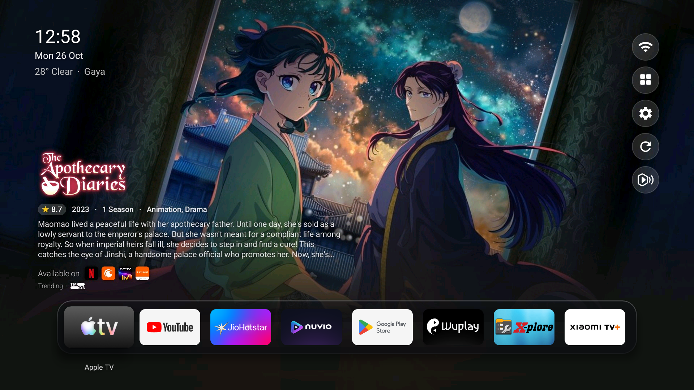
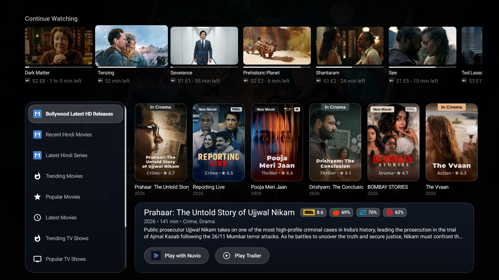
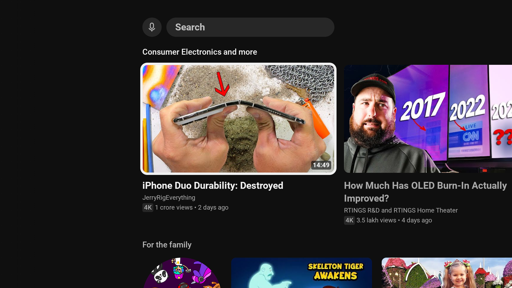
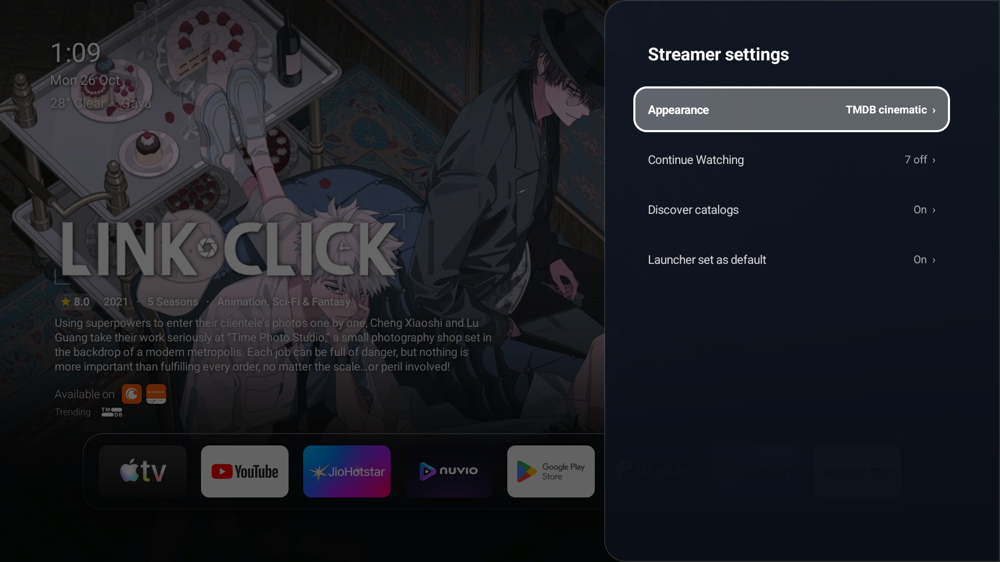
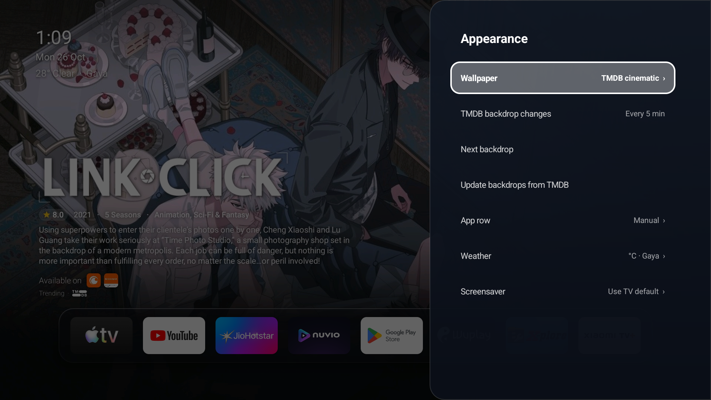
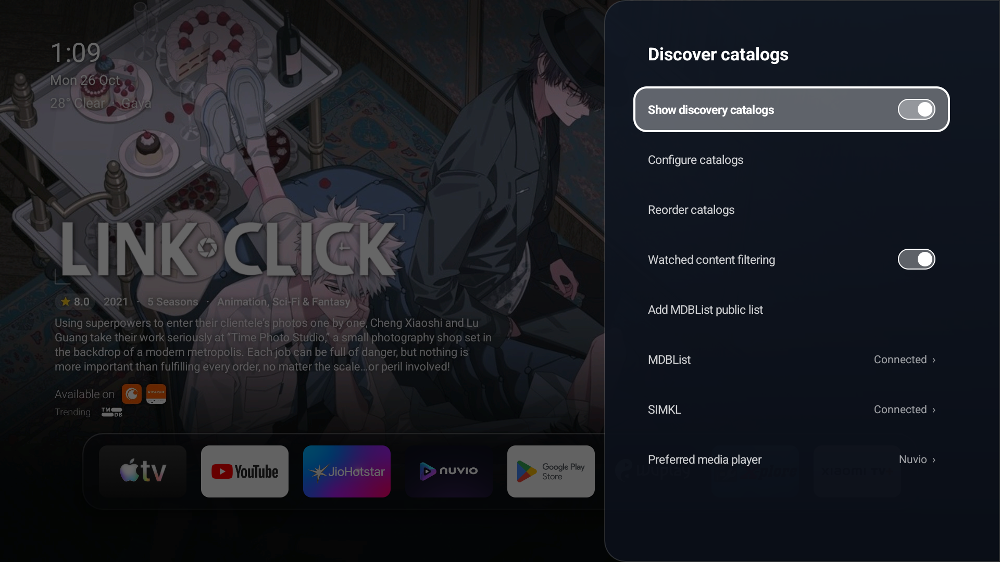

<h1 align="center">Streamer Launcher</h1>

<p align="center">
  <strong>An ultra-fast, minimal, and elegant home screen engineered specifically for Android TV and Google TV.</strong>
</p>

<p align="center">
  <a href="https://github.com/raviprakashji/Streamer-launcher/releases/latest"></a>
  
  
  <a href="https://github.com/raviprakashji/Streamer-launcher/actions"></a>
  
  <a href="LICENSE"></a>
</p>

---

## 📺 Product Showcase

<p align="center">
  <a href="https://github.com/raviprakashji/Streamer-launcher/releases/download/v1.0/streamer-demo.mp4">
    
  </a>
  <br>
  <em>🎬 <strong><a href="https://github.com/raviprakashji/Streamer-launcher/releases/download/v1.0/streamer-demo.mp4">Click here to watch the HD Video Demo (MP4)</a></strong></em>
</p>

### 📸 Core Interface

| 🏠 Home Screen (Page 1) | 🎬 Discover Catalogs (Page 2) |
| :---: | :---: |
|  |  |
| *Streamlined glass dock with adaptable icons, clock, and live weather.* | *TMDB Trending rows, ratings aggregator, and dynamic backdrop sync.* |

| ▶️ High-Definition Trailer Streaming | ⚙️ Streamer Settings Main Menu |
| :---: | :---: |
|  |  |
| *Built-in ExoPlayer 1440p / 1080p in-app trailer player with scrub bar and HD badge.* | *AMOLED dark frosted settings menu with fast categorized navigation.* |

---

### ⚙️ Settings & Configuration Submenus

| 🎨 Appearance Submenu | ⏳ Continue Watching Submenu |
| :---: | :---: |
|  |  |
| *Wallpapers (Rockies Day/Dusk, Pure black, TMDB cinematic), photo fade, and rotation timer.* | *Filter per-app sources and restore hidden shows with package icon badges.* |

<p align="center">
  <strong>🎬 Discover Catalogs Submenu</strong>
  <br>
  
  <br>
  <em>Toggle discovery catalogs, connect MDBList & SIMKL watchlists, and configure preferred media players.</em>
</p>

---

## 🌟 Key Features

- **🚀 Featherlight & Instant**: 
  - Sub-4MB APK footprint with instant cold boot.
  - Native heap footprint of only ~38 MB (45% leaner than standard TV launchers) for lag-free 60fps D-pad scrolling.
- **🎬 TMDB Discover Catalogs**:
  - Browse trending movies, popular series, top rated titles, and curated genres.
  - Dynamic synopsis cards with multi-platform ratings (IMDb, TMDb, Rotten Tomatoes, Trakt, Metacritic).
- **📋 MDBList & SIMKL Watchlists**:
  - Connect your personal or public MDBList and SIMKL watchlists.
  - Automatically fetches and updates watchlist rows directly onto the Discover page.
- **🍿 Built-In HD Trailer Streaming**:
  - Seamless in-app ExoPlayer trailer playback supporting up to 1440p / 1080p.
  - Video resolution badge, scrubbable progress bar, and instant play/pause without leaving the launcher.
- **🎯 Preferred Media Player Launcher**:
  - One-click launch to your favorite external video player: **Nuvio**, **Nova Player**, **Stremio**, **Just Player**, **Kodi**, **VLC**, **MX Player**, or prompt on every play.
- **⏳ Continue Watching Aggregator**:
  - Resumes ongoing media from Android TV Watch Next and supported media applications.
  - Hidden show management with app icon badges (`[app_icon] show_title`) and automatic pruning of uninstalled apps.
- **🎨 Wallpaper & Theme Adaptability**:
  - Adaptive contrast borders: smoothly curved poster corners with zero edge clipping.
  - Dynamic text and border illumination that automatically balances visibility across light wallpapers (e.g. Rockies Day) and dark AMOLED backgrounds.
- **🔒 Privacy & Layout Control**:
  - Rearrange, reorder, or hide apps from the home dock.
  - Optional parental/layout lock PIN.

---

## 🏗️ Technical Architecture & Implementation

```
┌────────────────────────────────────────────────────────────────────────┐
│                        Streamer Launcher Engine                        │
├────────────────────────────────┬───────────────────────────────────────┤
│         Data Layer             │              UI Layer                 │
│  • TMDB API Client             │  • Lightweight Android View Hierarchy │
│  • MDBList / SIMKL Engine      │  • SnapScrollView (60fps D-pad Paging)│
│  • Android WatchNext Provider  │  • DockPillView (Frosted Blur Glass)  │
│  • In-App YouTube Extractor    │  • Dynamic Backdrop Renderer          │
├────────────────────────────────┴───────────────────────────────────────┤
│                       Hardware & Media Pipeline                        │
│  • Media3 ExoPlayer 1.5.1 (1440p/1080p Video + AAC Audio Stream Mux)   │
│  • RGB_565 Decoded Bitmaps (Zero GC Stalls, 45% Native Heap Savings)   │
│  • LruCache Memory Gate (Bounded 8 MB Cache for Posters)               │
└────────────────────────────────────────────────────────────────────────┘
```

### 1. Zero-Overhead View Hierarchy
To guarantee uncompromising 60fps smoothness on budget Android TV sticks and smart TVs:
- Built strictly using lightweight framework `View` components (`FrameLayout`, `LinearLayout`, `ImageView`, `TextView`).
- Completely eliminates heavyweight runtime reflection frameworks and heavy Compose runtimes, saving tens of megabytes of RAM.

### 2. Extreme Memory & APK Optimization
- **Bitmap Memory Management**: Decodes non-transparent backdrops and wallpapers using `Bitmap.Config.RGB_565`, slashing texture memory usage in half.
- **Native Typography**: Removed redundant bundled `.ttf` fonts, utilizing Android's hardware-optimized system Roboto variants (`sans-serif-light`, `sans-serif-medium`).
- **Asset Modernization**: Bundled gallery artwork converted to high-compression WebP format, reducing asset footprint by over 70%.

### 3. In-App YouTube Stream Extraction
- Resolves YouTube trailer streams in-app using an adaptive stream manifest extractor (`InAppYouTubeExtractor.kt`).
- Merges separate high-bitrate video streams (up to 1440p) with clean AAC audio streams via ExoPlayer's `MergingMediaSource` without external companion apps.

---

## 🎮 TV Remote Navigation Guide

| Action | Remote Key / Gesture |
| :--- | :--- |
| **Move Focus** | <kbd>▲</kbd> <kbd>▼</kbd> <kbd>◀</kbd> <kbd>▶</kbd> Directional Pad (D-pad) |
| **Launch App / Media** | <kbd>OK</kbd> / <kbd>Enter</kbd> (Center Button) |
| **Switch Pages** | <kbd>▼</kbd> Down from dock transitions smoothly to Page 2 (Discover Catalogs) |
| **Quick Play / Trailer** | Highlight movie poster -> Press <kbd>▲</kbd> Up to access Play and Trailer buttons |
| **App Management** | Long-press <kbd>OK</kbd> on any dock app to rearrange or hide |
| **Back / Exit Modal** | <kbd>Back</kbd> key closes trailers, search dialogs, and settings panels |

---

## 📥 Installation

### Option 1: Direct APK Download
Download the latest pre-compiled release from the [Releases Page](https://github.com/raviprakashji/Streamer-launcher/releases/latest):
- **`Streamer launcher_v1.0.apk`** (3.8 MB)

### Option 2: Install via ADB
```bash
# 1. Connect to your TV over Wi-Fi
adb connect <your-tv-ip>:5555

# 2. Install the APK
adb install -r "Streamer launcher_v1.0.apk"
```

---

## 🛠️ Building from Source

### Prerequisites
- **JDK 17** (Temurin or OpenJDK recommended)
- **Android SDK** (API Level 36, Build Tools 34.0.0)

### Build Commands
```bash
# Clone the repository
git clone https://github.com/raviprakashji/Streamer-launcher.git
cd Streamer-launcher

# Run unit tests
./gradlew test

# Compile release APK
./gradlew assembleRelease
```
The compiled APK will be located at:
`app/build/outputs/apk/release/Streamer launcher_v1.0.apk`

---

## 📄 License

This project is licensed under the **GNU General Public License v3.0 (GPL-3.0)**. See the [LICENSE](LICENSE) file for complete details.
